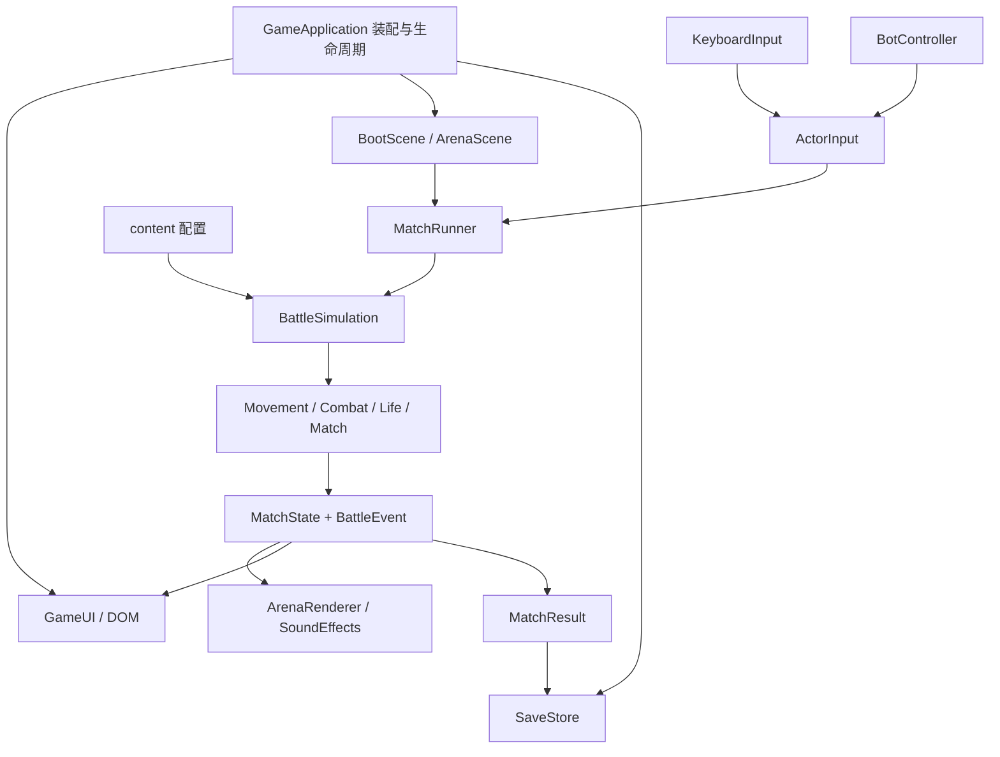

# 架构与第一阶段实现

更新：2026-10-18。对应 [PRD](./PRD.md) 的核心原型阶段；这是已落地代码说明，不是全量功能完成声明。

当前功能进度和验证证据见 [开发现状](./DEVELOPMENT.md)，任务依赖、共享接口与文件归属见 [并行开发计划](./PARALLEL_PLAN.md)。AI 接手前先读 [根目录协作约定](../AGENTS.md)。

各模块的独立任务文件见 [模块任务包](./modules/README.md)，文档与来源已全部位于本项目内。

## 1. 技术选择

| 部分 | 当前选择 | 原因 |
| --- | --- | --- |
| 语言 | TypeScript，严格类型与下标检查 | 让配置、指令、状态和事件的接口保持一致 |
| 2D 引擎 | Phaser 3 | 负责场景、绘制、相机及缩放 |
| 战斗物理 | 纯 TS 运动学、AABB 平台碰撞、线段扫掠弹道 | 直接控制单向平台、击退与同帧胜负，核心可独立测试 |
| 页面 | DOM + CSS | 菜单、设置、HUD 与键盘焦点可独立维护 |
| 工具链 | Vite、pnpm、Vitest、Playwright | 本地开发、锁定依赖、核心与浏览器验证 |
| 持久化 | 有版本的 localStorage，内存降级 | 首版无服务端依赖 |

运行时只依赖 Phaser。没有使用 Phaser Arcade Physics，避免同时维护两套会修改角色位置的物理系统。当前碰撞适用于静态、轴对齐平台；斜坡、可破坏和移动地形需要另行设计。

## 2. 依赖与数据流

- `game/**` 只使用纯 TS 和内容配置；禁止引入 `phaser`、浏览器全局或存储 API。
- `content/**` 定义结构化内容，类型来自 core；不启动场景或修改运行中状态。
- `presentation/**` 适配键盘、音效与绘制，消费状态和事件；不决定扣命与赢家。
- `scenes/**` 衔接 Phaser 的生命周期与运行器；输入监听按场景清理。
- `app/**` 决定菜单、对战、暂停、帮助、设置、外观、地图选择和结算的切换，以及何时保存。
- `ui/**` 发出用户操作回调；不直接修改角色位置或生命。

## 3. 状态与时间

### 对局状态

`countdown → playing → finished`；倒计时和对战均可进入 `paused`，恢复时重新进行三秒倒计时。加时复用 `countdown`，由 `overtime` 标记区别。

角色状态独立为 `alive / respawning / eliminated`。判断胜负使用剩余生命而非当前可见角色数，因此等待复活不会被误判为已淘汰。

### 每个固定逻辑步

`BattleSimulation.step` 当前执行顺序如下，炸弹、投放与训练均已接入：

1. 倒计时 / 暂停 / 结算状态先过滤；只在正式对战推进游戏时间。
2. 更新复活与保护计时。
3. 根据角色指令更新主动运动、外力、跳跃和地形碰撞。
4. `CombatSystem` 处理换弹、发射、弹丸扫掠 / 火箭爆炸，再由 `GrenadeSystem` 处理投弹、炸弹运动 / 引信 / 爆炸；爆炸解析器只返回命中与推力，由调用方应用。
5. 批量处理全部角色出界，记录生命与击出归因；已出界角色不能在本帧拾取。
6. `DropSystem` 推进箱子计时、生成投放、处理合法拾取；该帧已发射的攻击仍属于旧枪，新枪最早下一步使用，同一箱子每帧只发给一个角色。
7. `resolveMatch` 决定胜负、超时或加时；训练模式最后由 `TrainingSystem` 更新任务。投放位于本帧判胜之前，结算后后续逻辑步不再推进。
8. 步进完成后，绘制端消费状态，应用端处理结算，音效端消费事件。

`FixedStepLoop` 使用 1/60 秒逻辑步；单次绘制最多推进五步，超长停顿不无限追赶。暂停、菜单与结算清空累积时间。绘制端使用上一位置和当前位置插值，绘制帧率不参与物理公式。

角色坐标是身体底部中心。主动水平速度、竖直速度与击退外力分开；外力按时间衰减，不能被角色最大主动移速直接截断。

## 4. 输入与 AI

所有控制方生成同一个 `ActorInput`：`moveX`、`jumpPressed`、`dropPressed`、`shootHeld`、`reloadPressed`、`bombPressed`。跳跃 / 穿台 / 换弹 / 投弹使用按下边沿，射击使用持续状态；浏览器自动重复按键不会额外生成跳跃。键盘读取 `SaveData.bindings` 的实际映射，设置面板改键后即时重建允许键集合；AI 使用相同输入契约。

输入适配器只在正式对战拦截战斗键；编辑设置时不干扰输入。暂停、恢复、切换模式、失焦都会清空键状态。

默认映射集中于 `content/controls.ts`，键盘与 UI 共同消费。P1 使用 A/D、W / 空格、S、J、K 投弹、R 换弹；P2 使用方向键、Enter / 小键盘 0（小键盘 Enter 也可）、小键盘 1 投弹、小键盘 2 换弹，Esc 暂停。设置中的改键、冲突校验与持久化已接入。

规则 AI 具有独立的种子和反应计时，用同样的移动、跳跃、射击与生命系统。`Navigation.ts` 从地图平台构建可达图，控制器处理追击、缺口跳 / 穿台、下层返回和 1 秒无进展重规划；跳跃保留落台目标。三档策略的反应、追击距离、投弹概率不同，困难档近身后撤。射击范围为当前武器射程与难度范围的较小值（420 / 620 / 760 px）；已有炸弹规避、340 px 内抢箱和低弹匣主动换弹，逐枪选位和多人战术仍待精调。

### DeepSeek 外部输入扩展（2026-10-18）

外部角色使用 `ActorConfig.control = 'external'`，仍只向模拟提供原有 `ActorInput`。`MatchRunner` 的整数 playing tick、控制代次和 `ExternalInputController` 验证输入顺序 / 年龄，并在暂停、复活与加时等生命周期转换时清理。网络不进入 `src/game/**`。

`DeepSeekClient` 在浏览器外围复制状态、异步请求并投递完整动作；Node 网关由 Vite dev / preview 装配，读取服务端环境变量调用固定 DeepSeek API。请求最多一个在途，命令过期后释放操作；仅在无有效指令或角色已处于失足风险时，输入控制器发出有限的安全回台动作，不切换为完整规则 AI。数据白名单、限流 / 预算、路由、配置与验证边界见 [DeepSeek 接入说明](./DEEPSEEK.md)。原有本地模式不依赖密钥或网络。

网关的 `prepareModelContext` 对每次请求单独执行 512000 token 上限检查，包含 256 token 输出预留；使用 UTF-8 字节与消息封装余量保守估算，超限拒绝请求。每次发送固定规则、当前观测和最多 8 条动作摘要，不累计完整对局历史。网关会话负责角色归属、请求频率 / 额度及累计用量，与单次上下文长度分别管理。外部输入控制器仅在无有效指令或角色已接近平台 / 地图边缘时发出紧急回台输入，仍不修改核心状态。

## 5. 边界与保存

- 普通子弹使用扫掠线段与角色 / 实体矩形求交，选择第一个交点，避免高速穿透。单向平台不挡弹。
- 弹丸在发射时快照 `weaponId`、`velocity`、`impulse` 和剩余射程；换枪不改变已在飞行的子弹。
- 角色碰撞体完全越过淘汰边界才出界；角色状态改变后不能在后续帧重复扣同一条生命。
- 命中只施加击退，生命只因出界减少。自身子弹不命中自身，复活保护阻挡击退，主动开火移除保护。
- 角色当前武器是 `WeaponInstance`；出生、复活和加时从 `MatchConfig.startingWeapon` 恢复，拾取只换当前实例。冷却仍在角色上，切枪不重置。
- `content/weapons.ts` 的 `WEAPON_MODELS` 注册 17 个具体型号（基础 P92 + 16 标准型号），`WEAPONS` 保留六标准类别名及加特林 / 重炮两类终极；`getWeapon` 查询两者。基础手枪无限弹，其余使用弹匣 + 备弹 + 换弹，霰弹按型号配置弹丸数但一次扳机只扣 1 发。P1 R / P2 小键盘 2 手动换弹，空仓按住开火自动换弹；换弹期间禁射但可移动。`CombatSystem` 仅在弹匣和备弹都为空时回退一次到基础手枪，回退帧不额外射手枪；`WeaponSystem` 提供切枪 / 补满两池 / 换弹 / 回退入口。火箭共用爆炸服务；部分重武器用 `impulseCap` 突破普通 900 冲量上限。
- 时间耗尽先处理当帧出界；并列最高生命进入一命加时；加时超时平局。
- 存档为 v2，继续使用 `gun-brawl:save:v1` key；v1 读取时逐字段迁移，`recentResults` 保留最近 20 个结果 ID 用于交错重复去重，`clear()` 恢复全部默认值。训练不减少生命、不计正式统计，也没有时限；`TrainingSystem` 从合法输入和命中 / 击出 / 投弹事件记录六项任务，`SaveData.trainingCompleted` 持久化。训练台固定使用 `TRAINING_ARENA`，局部重置清空弹丸 / 炸弹 / 箱子并回到倒计时，但保留已完成任务；假人可由面板切换巡逻 / 静止。
- v2 存档还包含设置、最近模式 / 地图、基本战绩、最后结算 ID、P1 / P2 的外观 / 键位、`customMatch`、首次训练引导与战役进度；旧档缺失字段局部补默认，不丢失有效设置 / 战绩；损坏 / 冲突键位或非法自定义配置回退默认。没有保存未完成对局。
- 每局由应用生成 `matchId` 写入结果，和玩法种子解耦；旧调用缺省仍用 `seed-mode` 兼容。
- 存档写入失败时保留内存中的设置与统计，并显示一次提示。

## 6. 地图与外观表现

- `content/maps.ts` 注册四图，`getArena` / `isMapId` 统一查找和校验。`MapDefinition` 含主题、英文副标题、描述、强调色和安全 `dropPoints`；平台导航图由 `Navigation.ts` 从实际平台生成。
- `createMatchConfig(mode, seed, selections?)` 负责快速人机 / 本地双人 / 训练的两角色配置；`createCustomMatchConfig(settings, seed, selections)` 使用 `validateCustomMatch` 校验并创建 2—4 人配置，战役和 DeepSeek 各有独立创建器。应用显式传入存档选择与每局 ID；外观复制进 `ActorConfig.appearance`，避免编辑影响当前局。
- `BattleSimulation` 用 `MatchConfig.dropMode`（`all` / `standard` / `none`）给每局创建投放池；标准池不含加特林 / 重炮，`none` 为空池，不会生成箱子。
- `WorldArt.paintWorld` 由实际地图对象绘制背景与全部平台，供 Phaser 背景纹理和地图缩略图复用。背景为原创 Canvas 2D 程序画，无远程资源依赖。
- 三张主题图使用独立路线：双塔庭院、非对称屋顶和反应堆枢纽；训练台保留基线。建筑 / 支撑属于单向平台后的装饰，所有落脚亮边最后绘制并对齐碰撞坐标；地图卡片显示完整 16:9 构图，菜单角色站位也从实际平台推导。
- 主题图加宽主要落脚区，下层接应平台与两侧主路内缘重叠：内侧失足可落回并普通跳回，外围悬崖仍可被持续命中击出；悬空边缘警示从实际平台推导。地图验收同时检查失足恢复、合法互达、外围真实持续击出和单发主动救回，避免只验证可达性。
- `CharacterArt` 保留公开绘制入口及供工具使用的 22 帧网格图集（8 列，1920 × 864）；五位角色和全部混搭均通过 `characters/HumanoidRig` / `HumanoidArt` / `HumanoidView` 使用连续分层骨架及 1200 × 1152 部件图集。脸按 style、衣服 / 附件按 outfit、头饰独立分流至各画师。双手 IK 与枪身共用 `ArenaRenderer.weaponMounts`，场景必须先画身体，再将挂点传给 `WeaponLayer.draw`，不叠加旧手臂。编辑器与实战共用部件，以脚底为锚点，碰撞体保持 36 × 52，换装不改变战斗数值。见 [全角色骨架交接](./updates/2026-10-18-all-character-rigs.md)。
- 牛仔服装在同一骨架上增加 `CowboyClips` 关键帧、空中状态混合和 `LimbSkin` 双骨权重蒙皮。WebGL 通过八个原生 Rope 替换八个肢段 Image，其他附件与其他四套服装保留 Image；Canvas 外观预览使用相同顶点和小裁片三角形变换，Phaser Canvas 游戏渲染器使用刚性回退。图集尺寸 / 缓存上限不变，每人仍为 19 个部件对象。制作与资源说明见 [动画流程](./CHARACTER_ANIMATION_PIPELINE.md)。
- `ArenaRenderer` 分离背景、阴影、角色部件、特效和标签；身体连续组合待机、跑动、空中、落地、换弹与受击，开火不覆盖步态；`WeaponLayer` 消费同一世界挂点。枪口火光首次绘制时按挂点定位并快照，核心弹丸出生点仍使用逻辑枪口，动画中二者可能略有偏差。非 playing 阶段冻结视觉时间，复活清理视觉瞬态。四张背景按 ID 缓存，部件图集稳定最多保留 8 组，清理时跳过正在使用的图集；场景销毁释放资源。
- 独立编辑组件在 `ui/appearance/`，地图选择在 `ui/maps/`。主 UI 通过应用回调保存；编辑过程中切换窗口不推进战斗。若从对局 / 结果进入，修改在下局应用；从菜单进入则同步更新菜单预览。

## 7. 后续扩展点

| 功能 | 建议落点 | 需要保持的约束 |
| --- | --- | --- |
| 武器表现与平衡 | 17 型号与两类终极、有限弹 / 换弹 / 回退已实现；逐枪装填 / 真实音色与人工平衡待续 | 射击行为由配置与实例驱动，HUD 不写死手枪；切枪不改变在途弹丸；终极武器只从箱子 / 训练获得 |
| 炸弹和爆炸 | `ExplosionResolver` 签名已冻结；T02 实现共享计算 / 炸弹系统并新增事件 | 解析器不直接改生命；保持同帧统一出界与胜负判定 |
| 武器箱 | DropSystem 与地图正式投放点配置 | 核心决定归属，画面只显示落点与拾取效果；终极武器低权重 |
| 地图投放与导航 | content/maps 的点位 / 路径配置 | 四图已按实际配置绘制，新增数据要同步投放、AI 与测试 |
| 自定义 / 战役 | 自定义 2—4 人和六关战役已接；完整人工平衡与 4 真人输入待续 | 所有模式复用 BattleSimulation |
| 手柄 / 鼠标侧键 | 新输入适配器；键位编辑与持久化已接 | 继续输出 ActorInput |
| 更复杂 AI | BotController 拆出导航和战术决策 | 不直接移动角色或更改弹量、生命 |
| 网络对战 | 新增网络指令适配器与服务器裁定 | 固定步长不自动意味着跨网络确定性；还需同步、快照、延迟与校验设计 |

避免为尚未实现的功能创建空系统和假入口。当前保留清晰接口；需求落地时补充实际数据与规则。

## 8. 验证

- `pnpm typecheck`：严格类型检查。
- `pnpm test`：当前 234 项 / 26 文件通过，覆盖移动 / 击退 / 生命、武器 / 爆炸 / 投放、地图 / 导航、模式 / 存档 / 输入、DeepSeek 契约 / 网关及角色骨架 / 全武器握点。详细范围见开发现状与各次交接。
- `pnpm test:browser`：在真实 Chromium 浏览器检查菜单、画布、键盘、训练、暂停恢复、失焦、设置、双人、重赛、刷新保存和被禁用的存储。
- `pnpm test:visual`：五种造型、混搭、独立保存、四张实际对局地图、暂停修改下局生效、重赛，以及 1024 / 720 / 390 像素视口。
- `pnpm build`：生产构建，Phaser 单独分包。

当前测试不等于 PRD 30 条全量验收，也没有声称达到参考机 60 FPS 或首屏加载指标；完整性能与全部武器 / 地图验收在相应功能完成后进行。

### 背景音乐

presentation/music 负责本地音频解码、循环、淡入淡出、暂停偏移和 Web Audio 生命周期；无法解码时由确定性 TypeScript PCM 回退，应用层负责场景选曲与存档。
