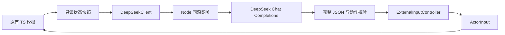

# DeepSeek 直接操作接入与交接

更新：2026-10-18。任务：EAI-D，承接 [外部 AI 调研](./EXTERNAL_AI.md)。

本轮按用户确定的方向实现：**发送游戏状态，通过 DeepSeek API 返回操作指令**。不使用视觉模型，不使用规则 AI 暗中代打。提供一名本地玩家对一名 DeepSeek 的独立入口；尚未支持全 AI 观战、多个外部模型混战或学习训练。

## 启动

本轮已生成空白 `.env.local` 供填写。新检出项目如果没有该文件，在项目根目录执行：

```powershell
if (-not (Test-Path .env.local)) { Copy-Item .env.example .env.local }
```

编辑 `.env.local`，填入自己的 DeepSeek API Key：

```dotenv
DEEPSEEK_API_KEY=填入自己的密钥
DEEPSEEK_MODEL=deepseek-flash
DEEPSEEK_MAX_REQUESTS=180
DEEPSEEK_INTERVAL_MS=500
DEEPSEEK_TIMEOUT_MS=10000
DEEPSEEK_CONTEXT_TOKENS=512000
DEEPSEEK_THINKING=enabled
DEEPSEEK_REASONING_EFFORT=low
```

然后启动或重启：

```powershell
pnpm install
pnpm dev
```

打开终端显示的本地地址，点击主菜单的 **DeepSeek 对战 → 挑战 DeepSeek**。使用当前已选地图、P1 外观和键位，每人三命、三分钟。设置检查不会调用模型，正式开打才产生推理请求。没有密钥时仍可玩原有全部本地模式，DeepSeek 开始按钮禁用并说明配置方法。

生产构建的本地预览也支持同源网关：

```powershell
pnpm build
pnpm preview
```

`.env.local` 已被 `*.local` 忽略，不应提交。不要使用 `VITE_DEEPSEEK_API_KEY` 或把密钥填入前端存档。Vite 配置在 Node 端加载环境变量，只将非敏感连接信息返回页面。

接口格式已按官方正文核实。初始接入阶段使用模拟响应验证；在配置本地密钥后已完成一次短时真实链路检查，确认请求能返回合法动作。这个样本只用于排查连接、超时和动作接收，不能据此推断模型胜率或长期策略水平。

## 实际数据流



网关由 Vite 的开发 / 预览中间件承载，无需另开一个服务进程。使用固定上游 `https://api.deepseek.com/chat/completions`，模型从服务端环境配置，默认 `deepseek-flash`。请求启用 JSON Output 和 thinking（默认 `low` 推理档位），最多输出 4096 token，以给模型留出判断生存、路线和攻击窗口的空间；不会流式执行半截命令，也不自动重试同一旧观测。可用 `DEEPSEEK_THINKING=disabled` 回退到快速模式，或用 `DEEPSEEK_REASONING_EFFORT=high|max` 提高推理强度。默认决策间隔为 500 ms；每次请求带最近最多 8 条动作和边缘 / 路线 / 威胁 / 最近敌人 / 目标对齐 / 武器击退等派生战术观测。

普通玩法仍能作为静态文件部署；DeepSeek 功能依赖 Node 网关。只有静态文件的托管不能运行该功能。当前网关限定 localhost / 127.0.0.1 和同源请求，属于本地开发与预览实现，未设计公共账号、远程访问或公开额度分配。

## 单次对话请求的 512K 上下文上限

每次模型请求包含固定规则、当前战场观测和最近最多 8 条动作摘要，不累计完整观测或无限对话历史。同一局内的短期动作记忆由浏览器按控制代次维护，网关会话仍用于角色归属、单请求在途、请求额度和用量统计，不代表模型拥有无限持续记忆。

**每次请求**的上下文默认且最多 **512000 token（512K）**，包含输入预算和预留的 4096 token 输出。该限制不是整局累计 token 额度。`DEEPSEEK_CONTEXT_TOKENS` 可设为 4096—512000 的整数，更大的值会被限制为 512000；无效值回退默认值。已有 `.env.local` 没有该配置时同样使用 512000，不需要覆盖本地密钥文件。`max_tokens` 为 4096，覆盖 thinking 的内部推理和最终动作 JSON；最终可见动作仍必须是短 JSON。

没有引入模型专用 tokenizer：按内容 UTF-8 字节数、每条消息 32 和请求级 1024 的封装余量保守估算。当前请求加输出预留超过上限时返回 `CONTEXT_TOO_LARGE`，不花请求预算，客户端停止重试；不会截断战场状态。真实 token 往往低于该估算。输入请求体和上游响应的 64KB 限制仍分别适用，现有观测通常远小于 512K；512K 是允许的上限，不是每次填满或生成的长度。

真实 usage 继续用于累计消耗展示。无效输出、上游失败和取消请求不影响下一次请求的上下文；新的请求总是重新读取当前状态。累计计费 token 和单次上下文长度分别统计，单局请求次数额度仍按原配置执行。

状态和开局接口返回 `contextTokens`；操作成功额外返回 `context: { limitTokens, estimatedInputTokens }`，只描述本次请求的上限和输入估算。配置页面显示“单次请求上下文上限 512K token”。

这不是传统的多轮聊天窗口：每次决策都重新发送固定规则（system）和当前状态（user），只携带最近最多 8 条动作结果作为短期记忆。模型必须返回动作 JSON，不能在对局中提问或输出自然语言。这样可以避免把旧坐标越积越长，但也意味着局间长期策略记忆（playbook）仍是后续工作。

## 模型看到的信息

- 对局与角色 ID、整数逻辑 tick、剩余时间。
- 地图平台、实体 / 单向类型、淘汰边界、坐标与运动规则。
- 自己的位置、速度、朝向、落台、剩余跳跃、生命、枪型、弹匣 / 备弹和自己的冷却；武器还包含弹速、单发击退、弹丸数和爆炸半径。
- 派生战术量：距地图左右边界、距当前平台左右边缘、最近存活对手的相对位置 / 距离 / 是否对齐 / 是否在射程内、平台路线 / 回台平台、最近弹丸 / 炸弹威胁、最近箱子和当前战术优先级。
- 对手位置、速度、朝向、落台、生命、状态和当前武器；不传对手弹匣、内部冷却或跳跃缓存。
- 最近最多 48 个弹丸，以及当前炸弹和箱子。炸弹精确引信、未来投放随机和核心种子不发送。
- 最近最多 8 条自己的动作（tick、方向、按键、持续帧数和最近一条动作结果），只在同一控制代次内保留，暂停 / 复活 / 重赛会清空。动作结果包含位移、当前落台和是否仍在地面，模型可以据此判断上一条操作是否卡住。

这是读取精确遥测的状态接口模式，不是模拟人类视觉。角色坐标是身体底部中心，x 向右、y 向下；速度包括主动运动与击退外力。观测复制字段，不能通过修改快照反向改动模拟。网关再次按白名单提取字段、限制数组数量和请求体大小，前端附加字段不会进入提示词。

## 返回指令

```json
{
  "intent": "attack",
  "moveX": -1,
  "jumpPressed": false,
  "dropPressed": false,
  "shootHeld": true,
  "bombPressed": false,
  "reloadPressed": false,
  "holdFrames": 30
}
```

`intent` 是可选的高层偏好，可取 `recover`、`attack`、`collect`、`reposition`；本地执行器会据此选择平台路线、回台、抢箱或攻击技能。`moveX` 只能为 -1 / 0 / 1，其余五项是布尔值；`holdFrames` 为 1—45 的整数。跳跃与穿台不能同时开启。

移动 / 开火持续到有效期结束；跳跃、穿台、换弹和投弹只在第一逻辑步触发一次。模型指令过期或网络等待期间，本地 60Hz 战术层会继续追击、瞄准、回台和换弹；攻击意图在目标进入射程且同高时会补足开火，避免思考延迟让角色站住。边缘和落空时仍由有限的安全输入优先回台；它不修改位置，也不改变命中、碰撞、弹量、保护、扣命和胜负规则。

每次请求携带独立会话、单调命令序号、控制代次和观测 tick。网关从请求记录回填这些信息，浏览器验证匹配后才接受。模型不能指定角色权限或改写物理状态。

## 频率与有效期

| 项目 | 当前实际默认值 |
| --- | --- |
| 游戏模拟 | 60 Hz，不等待网络 |
| 请求间隔 | 起始请求之间至少 500 ms，每角色只允许一个请求在途 |
| 远端超时 | 10000 ms；浏览器另加 1000 ms 传输余量 |
| 最大观测年龄 | 180 个 playing tick，即 3 秒模拟时间 |
| 最长持续操作 | 45 帧，即最多 0.75 秒 |
| 指令截止 | `min(接收 tick + holdFrames, 观测 tick + 180)` |
| 单局请求预算 | 180 次，可配置为 1—360 |
| 单次服务启动总预算 | 600 次，重启 Node 服务重置 |
| 同时会话上限 / 会话有效期 | 8 个 / 20 分钟 |
| 单次请求上下文上限 | 默认且最多 512000 token，含 4096 token 输出预留；保守估算，只带最近 8 条短期动作历史 |

暂停不推进 playing tick，但会清空输入、改变控制代次，并取消在途请求。恢复倒计时、死亡 / 复活、加时重置同样使旧指令失效。退出菜单、重赛和场景销毁会关闭旧连接；新对局生成新 ID 与会话。已淘汰、暂停和倒计时期间不发推理请求。

无效 / 空内容 / 截断响应、网络超时和临时限流后退避至少 2.5 秒再观察；密钥无效、余额不足、预算用尽和会话失效则停止继续请求并显示原因。取消请求不能承诺已经开始的推理不计费。

HUD 显示连接 / 思考 / 最近操作、已接收决策数、响应延迟、请求数及模型报告的累计 token。失败响应如果仍有 usage 也计入；网络中断时无法确认全部远端用量，这不是账单。

**实时直接控制的边界**：真实短测中单次思考约 2—3 秒，因此当前采用“模型定方向 + 本地 60Hz 执行”的混合控制；它能减少站桩和漏开火，但不能把延迟模型变成逐帧反应的职业玩家。同步步进评测、更多真实对局样本和低延迟动作模型仍是后续选项。

## 文件与公共接入

| 文件 | 职责 |
| --- | --- |
| [Protocol.ts](../src/game/ai/external/Protocol.ts) | 快照 DTO、指令类型、浏览器 / 核心动作校验 |
| [ExternalInputController.ts](../src/game/ai/external/ExternalInputController.ts) | 纯 TS 输入信箱、序号 / 代次 / 有效期、边沿消费 |
| [DeepSeekClient.ts](../src/adapters/ai/DeepSeekClient.ts) | 异步传输、单请求在途、取消、退避、状态与用量 |
| [deepseek.mjs](../server/ai/deepseek.mjs) | Node 网关、密钥、会话、观测白名单、限流、上游调用与响应校验 |
| [context-budget.mjs](../server/ai/context-budget.mjs) | 单次请求 512K 上限、保守输入估算和输出预留 |
| [DeepSeekSetup.ts](../src/ui/DeepSeekSetup.ts) | 配置状态与开局视图 |
| [vite.config.ts](../vite.config.ts) | 开发 / 预览网关装配；忽略 Windows 原子写临时文件 |

公共文件接入：`ActorConfig` 新增 `external / deepseek`；`MatchRunner` 新增 tick、控制代次和输入投递；`ArenaScene` 创建 / 清理适配器；`GameApplication` 处理开局 / 重赛 / 对话框取消；`GameUI` 增加独立入口与状态。`createDeepSeekMatchConfig` 保留底层 `duel-ai` 规则，因此战绩计入普通休闲统计，不增加存档版本或强制保存模型模式。

API 路由：`GET /api/deepseek/status` 检查配置；`POST /api/deepseek/session` 创建或关闭会话；`POST /api/deepseek/action` 发送状态并得到一条指令。没有允许浏览器设置上游 URL、模型密钥、提示词或任意代码执行的接口。

## 验证与接手

```powershell
pnpm test
pnpm build
# 先启动 pnpm dev
pnpm test:deepseek
pnpm test:browser
```

专项自动化覆盖：真实运动 / 射击 / 一次跳跃与投弹；过期 / 重复 / 未来命令；跨暂停 / 复活回复；快照隔离；单请求在途；预算停止；同源与白名单；密钥 / 余额错误；空 / 截断 / 非法响应；上游截止和断线取消。

512K 追加回归覆盖：同局连续请求和跨局请求发送规则 / 当前观测，并由浏览器附带有界动作摘要；失败后请求独立、单次预算不累计、512K 边界与输出预留、UTF-8 多字节保守计数，以及当前请求放不下时零上游调用 / 零请求消耗。

`test:deepseek` 使用浏览器拦截模拟响应，验证实际角色因模型指令移动、暂停时停止请求、预算用尽停止、重赛新身份和返回菜单清理。它只读取真实网关的配置状态，**不会调用付费模型**。截图在 `artifacts/deepseek-*.png`，文件名带 `mock` 的图明确为模拟响应。

首次接入（EAI-D）实际执行结果：

| 检查 | 结果 |
| --- | --- |
| 联合 `pnpm test` | 269 项 / 31 文件通过，包含外部 AI、地图、武器与存档回归 |
| `pnpm build` | 严格类型与生产构建通过 |
| 密钥隔离 | 使用测试哨兵作为服务端环境变量构建，全部 `dist` 文件中未发现哨兵内容 |
| `pnpm test:deepseek` | 开发服务和生产预览均通过；模型响应全部模拟 |
| `pnpm test:browser` | 生产预览完整通过：原模式、键盘、暂停 / 恢复、设置、重赛、持久化与存储阻断 |
| 文档 / 差异 | 路径、围栏与空白检查通过；`.env.local` 被 Git 忽略 |
| 真实 DeepSeek | 已完成一次本地短测：3 条 HTTP 200 动作，最近一次约 2.5 秒；无胜率结论，未将密钥写入仓库 |

单次请求 512K 上限（EAI-C）：联合 `pnpm test` 269 项 / 31 文件、严格类型 / 生产构建以及独立生产预览的 `test:deepseek` 均通过。网关在同一会话中连续请求携带固定规则、当前观测和最多 8 条动作摘要，不累积完整对局历史；页面明确显示单次请求上限。浏览器覆盖角色运动、暂停 / 旧回复、预算停止、重赛、菜单清理和 1280×800 配置视图，截图检查通过。网关状态返回 `contextTokens: 512000`，文档链接 / 围栏和差异空白检查通过。全部操作响应为模拟，未调用付费模型。

浏览器验证修复了原生 `fetch` 被类方法错误绑定的问题，Node mock 单测无法覆盖这一差异。开发服务也曾因 Windows 原子写入的 `.tmpdir` 文件监控报 EBUSY 退出，已补充忽略规则。开发版普通回归曾在存储阻断页等待超时，单独复现正常，最终使用稳定生产预览完整通过；不将该失败记录当作已测得的模型问题。

后续先配置真实密钥，打少量对局并记录延迟、有效指令率、空等待占比、请求数和实际消耗；再判断是否调整频率、动作持续时间或开发同步步进模式。没有足够样本前不提高默认预算或宣称优于规则 AI。

## 官方依据

已于 2026-10-18 抓取并核对：

- [首次调用与当前模型名称](https://api-docs.deepseek.com/)：固定 API 地址与 Bearer 认证；本次文档列出的 Flash 名称为 `deepseek-flash`，可用环境变量覆盖。
- [JSON Output](https://api-docs.deepseek.com/guides/json_mode/)：`response_format: json_object`、明确 JSON 提示、截断及空内容处理。
- [Chat Completions 参数](https://api-docs.deepseek.com/api/create-chat-completion/)：`thinking`、`max_tokens`、非流式响应、`finish_reason` 与 usage。
- [错误码](https://api-docs.deepseek.com/quick_start/error_codes/)：认证、余额、限流及服务错误。
