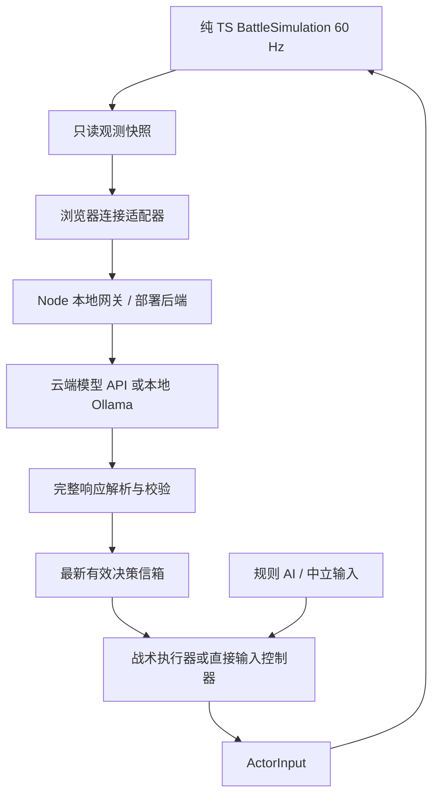

# 外部 AI 玩游戏：调研与接入设计

调研日期：2026-10-18。任务：T05-E。代码基线：`6b8a6f4`，工作区 `D:\Code\gun-brawl` / `main`。

**状态：调研归档，后续 DeepSeek 直接操作首版已接入。** 用户随后明确选择“状态接口 → 模型返回操作”，实际配置、代码与验证边界见 [DeepSeek 接入说明](./DEEPSEEK.md)。本页保留原调研的路线比较与设计提案，参数 / 任务表不代表最新实现；战术辅助、视觉与强化学习仍属后续。调研和本次接入均未调用真实付费模型，也没有模型胜率结论。现有规则 AI 的交付见 [导航与三档 AI](./updates/2026-10-18-ai-navigation.md)。

## 1. 结论与首版范围

可以通过外部模型让 AI 实际参加对局，现有 TypeScript 架构适合做这件事。首版建议实现 **结构化游戏状态 → 外部模型选择战术 → 本地动作执行器 → 原有战斗模拟**。模型负责目标、位置和时机，本地执行器负责连续移动、跳跃、朝向和开火，双方共同构成一个 AI。

同时保留一个“模型直接操作”实验模式：模型决定左右、跳跃、开火等原始输入，本地只做协议校验和一次性动作消费。它更适合衡量模型自身操作能力；先在等待决策的步进环境验证，再测试实时表现。

首版可做一名本地玩家对一名外部 AI，支持云端提供商或本地 Ollama 二选一。先证明模型决策确实改变角色行为，再增加多模型混战、观战和长期学习。

### “真实 AI”分别指什么

| 路线 | 决策来源 | 在本项目中的用途 | 限制 |
| --- | --- | --- | --- |
| 现有规则 AI | 手写规则、平台导航、种子随机 | 基线对手、断线接管、动作执行参考 | 行为依赖预写规则，没有外部模型 |
| 大模型 Agent | 经过训练的外部模型，根据观测调用动作接口 | 战术变化、不同作战风格、对局分析 | 请求有延迟和成本，不自动获得精确操作能力 |
| 视觉 Agent | 模型从截图或视频理解局面，再输出操作 | 验证“只看画面”的能力 | 识别误差、图像开销、时序理解和延迟都要测 |
| 强化学习策略 | 用对局轨迹和奖励训练的小型策略网络 | 需要快速反应和稳定操作的竞技 AI | 要开发训练环境、训练及验证模型，不能只接一个聊天接口 |

现有规则 AI 也是游戏 AI；接入大模型的实际收益需要对照实验。调用外部模型属于推理，不等于它会边玩边更新模型权重。保存战术记忆、调整提示词、训练策略是三件不同的事。

## 2. 当前代码已经提供的基础

| 代码入口 | 已实现的事实 | 接入意义 |
| --- | --- | --- |
| [输入与状态类型](../src/game/core/types.ts) | 所有角色共用 `ActorInput`；控制类型只有 `human / bot / dummy` | 后续增加外部控制类型或注入控制器，不需要另一套物理 |
| [MatchRunner](../src/game/core/MatchRunner.ts) | 每个固定步采样键盘或 `BotController`，交给同一模拟 | 控制器注入点；这里应保持同步，不能等待 HTTP |
| [BattleSimulation](../src/game/core/BattleSimulation.ts) | 接收每个角色的输入，统一处理移动、攻击、出界和胜负 | 模型只能交输入，不能改位置、弹药、生命或胜负 |
| [BotController](../src/game/ai/BotController.ts) | 三档反应、追击、回台、抢箱、避爆、投弹与换弹 | 可拆出动作技能，也可作为显式降级基线 |
| [Navigation](../src/game/ai/Navigation.ts) | 基于平台的 `walk / jump / drop` 路线 | 给战术目标寻找通路；启发式可达边不等于物理保证 |
| [固定步长](../src/game/core/FixedStepLoop.ts) | 60 Hz，单次绘制最多追赶五步 | 模型请求必须异步；不能靠等待网络推进游戏时间 |
| [ArenaScene](../src/scenes/ArenaScene.ts) | 持有运行器、接收输入、处理场景生命周期 | 在外围装配观测、连接和取消，不把网络放进纯核心 |
| [自定义对局](../src/content/matches.ts) | 2—4 人，至少一名本地玩家；P1 必须参战 | 外部槽位、全 AI 对局和观战入口均尚未支持 |

额外注意：`BattleSimulation` 构造器本身也禁止全 AI 配置。将自定义页面改成全 AI 仍无法开局；需要集成者一起调整核心配置校验与专用评测构造器，不能用假人类身份绕过。

当前 `BotController` 不是一个可接收任意战术的执行器：它自行挑最近对手，并把抢箱等行为写在内部。混合方案必须实际拆出技能或增加意图输入，不能把模型结果仅写进日志，角色仍完全按旧规则行动。

## 3. 三种接法及优先级

### A. 结构化状态 + 战术技能：推荐首版

模型收到“自己在下层、敌人在右侧、右侧有箱子”等状态，返回 `attack / collect / retreat / recover / hold`。本地控制器把意图转换为合法输入，在每个模拟步执行。遇到即将出界、炸弹威胁等情况可以按预先声明的辅助规则临时接管。

这条路线省去图像识别，容易回放、定位错误和比较模型。它属于有动作辅助的 Agent，需要在评测报告中写明辅助范围。

### B. 状态或截图 + 原始动作：直接控制实验

模型返回 `moveX`、`shootHeld` 和跳跃等操作，适配器转换成 `ActorInput`，不做自动追人、自动回台或自动避弹。只有格式、权限、动作有效期和游戏本身的物理规则会约束操作。

先提供独立评测运行器：产生观测 → 等待模型 → 执行 6—12 个固定帧 → 产生下一次观测。等待期间不推进模拟，所以能测试推理能力，但这不是实时对战结果，必须同时报告模拟时间与现实耗时。

实时直接控制另测：即使 HTTP 或 WebSocket 连通，模型响应速度也未必能满足连续操作。截图方案还需提供连续帧或明确的时序信息；单张图不能可靠表示速度和跳跃过程。OpenAI 官方文档说明了图像输入及空间定位等限制，图像预算也与模型、尺寸和 detail 有关。[S4]

### C. 强化学习 + 本地推理：后续竞技路线

用同一 TS 模拟构建 `reset / step` 环境，通过进程通信连接 Python 训练端，再将可导出的策略交给 ONNX Runtime Web 或 Node 推理。Gymnasium 的环境契约和 Stable-Baselines3 的 PPO 可以作为候选起点，尚未为本游戏验证。[S6][S7][S8]

观察可从固定长度向量开始：自身运动、附近敌人、平台、弹丸、箱子等；必须声明最大数量、排序、补零和可见性掩码。动作可用离散技能或经约束的按键组合。训练中区分真正终局与外部截断，不能把暂停、断线或训练步数上限都视为死亡。

奖励以最终胜负、真实击出、自身掉落为主，避免无限刷命中、原地存活或抢箱也能刷高分。先训练回台与移动，再加入对手、武器和自博弈；训练耗时、胜率与浏览器推理速度均待实测。

## 4. 推荐运行架构



首版的游戏仍在浏览器中运行，Node 网关只做模型接入，不承担权威物理。以后若做公开的多客户端对战或可信排行榜，再单独设计服务端权威模拟；这个原型不能直接当成防作弊服务器。

- **纯核心 `src/game/**`**：观测 DTO、意图、输入控制器和确定性的指令校验；不引入网络、DOM、密钥或墙钟。
- **浏览器外围适配器**：复制观测、节流、收取决策、连接清理。HTTP 或 WebSocket 都可，WebSocket 本身不会消除模型推理延迟。
- **Node 网关**：提供商 SDK、密钥环境变量、超时、速率限制、用量统计和响应规范化。密钥不能进入 Vite 的 `VITE_*` 环境变量或浏览器 localStorage。
- **运行器**：从最新信箱同步采样输入，不在 `advance()` 或 `step()` 内 `await`；模型慢时模拟继续。

本机网关默认只监听回环地址，核对允许的前端 Origin，并验证会话、角色及请求归属；浏览器只能选择服务端配置好的提供商，不能提交任意上游 URL。远程部署时再补充相应身份验证和访问预算。

## 5. 观测设计：给模型哪些信息

不直接序列化完整 `MatchState`。构建版本化、不可变的字段白名单，每次从模拟复制快照；避免异步请求读取正在变化的对象。

| 部分 | 建议内容 | 注意事项 |
| --- | --- | --- |
| 静态规则 | 击退出界获胜、跳跃限制、动作说明、武器与地图版本 | 由程序生成，随内容版本变化；不复制过时 PRD 参数 |
| 地图 | 坐标系、平台矩形及类型、淘汰边界、地图摘要 / 版本 | 左上为原点、y 向下；角色位置为身体底部中心 |
| 自身 | 位置、运动速度、朝向、落台、跳跃次数、生命、状态、当前枪、弹匣、备弹、换弹 / 冷却 | 总运动还受到 `impulse` 影响，不能只发 `moveVelocity` |
| 对手 | ID、公开位置 / 朝向、状态、可见武器及生命 | 公平档不发送对手精确弹匣、内部冷却、跳跃缓存 |
| 战场 | 可见弹丸 / 炸弹 / 箱子及预告、必要的短事件摘要 | 不发送下一次随机投放、未来弹道或未公开结果 |
| 动作上下文 | 可选目标 / 平台 ID、当前可用动作提示、上次动作结果 | 提示只是候选，实际执行仍检查最新状态 |

提供三种明确标记的观测档位：

1. `visible-state`：规则约定的公开实体及自身信息，屏蔽对手内部状态。精确坐标仍来自接口，不等于人类视觉。
2. `full-state`：调试用，允许当前精确计时等额外信息；报告不能与公平档混算。仍不暴露未来随机结果。
3. `vision`：只给规则、截图和声明过的可见 HUD / 历史帧；不暗中夹带坐标。若使用自身遥测，另标为混合视觉档。

初始地图和规则可保存在网关会话中，动态快照按需发送；模型请求仍需具备完整的决策上下文。“网关只收增量”不等于模型自动记住地图，也不保证减少计费输入。所有历史、摘要与缓存都要有长度上限和版本失效机制。

## 6. 决策协议与输入语义

下面是内部协议提案，不是已经存在的类型，也不是某一提供商的请求格式。

```ts
interface ObservationEnvelope {
  protocolVersion: 1;
  episodeId: string;        // 宿主生成；不依赖可选的 MatchConfig.matchId
  controlEpoch: number;     // 暂停、重赛、加时重置等使旧控制失效
  actorId: string;
  lifeEpoch: number;        // 每次死亡 / 复活使旧命令失效
  observationTick: number;  // 新增的整数模拟步序号，不用浮点 elapsed 充当 ID
  requestId: string;
  mapRevision: string;
  // payload: 按观测档位裁剪后的 DTO
}

interface TacticalDecision {
  intent: 'attack' | 'collect' | 'retreat' | 'recover' | 'hold';
  targetActorId: string | null;
  targetDropId: number | null;
  targetPlatformId: string | null;
  combat: 'auto' | 'cease-fire';
}
```

模型只返回决策对象。网关从请求记录附上 envelope 和有效期，不能信任模型自行填写的角色、tick、权限或过期时间。为各提供商分别生成支持的 JSON Schema；某家支持 JSON 输出，不代表它支持另一家的工具参数或严格 schema 子集。

执行器明确解释意图：`attack` 追击指定对手并按当前武器选位；`collect` 到指定箱子并在箱子消失后报告失效；`retreat` 向指定落脚区撤离；`recover` 优先回到可站立平台；`hold` 在目标区域内活动。`combat:auto` 允许本地按朝向、距离、遮挡和弹量决定射击 / 换弹 / 投弹，不能越过 `cease-fire` 擅自开火。辅助规则与中断原因记录到轨迹。

跳跃路线需要拆成“到起跳点 → 起跳 → 必要时二段跳 → 确认落台”的持续技能；导航图只是候选路线。箱子失效、目标复活、路径不通、连续无进展时停止或重规划，不照旧命令继续向悬崖走。

### 直接操作模式

使用现有六个 `ActorInput` 字段，并附宿主确定的命令序号、有效期和持续步数。当前没有鼠标瞄准或自由角度输入，朝向随 `moveX` 改变，模型不能输出尚未实现的瞄准动作。

- `moveX / shootHeld`：在命令有效期内维持，到期清空；持续步数由程序上限约束。
- `jumpPressed / dropPressed / bombPressed / reloadPressed`：同一命令只在第一个有效逻辑步输出一次。后续采样清零，重复网络消息不再触发。
- 真正的新命令可以再次跳跃，但能否二段跳由模拟判定；不能每帧重复播放一次 `jumpPressed:true`。
- 同帧互斥操作按固定规范处理，例如跳跃与穿台冲突拒收或采用明确优先级。现有模拟还会检查库存、冷却、状态和保护规则。

**严格直接模式**到期只回到中立输入，不偷偷自动寻路或回台；**辅助战术模式**可交给规则 AI 接管。中立输入也不保证安全，已有惯性仍可能使角色掉落。日志区分模型控制、技能执行、安全中断和超时降级，避免把规则 AI 的结果算成模型能力。

## 7. 频率、延迟与生命周期

### 初始实验参数

| 项目 | 起始建议 | 性质 |
| --- | --- | --- |
| 战术请求 | 每个角色 1 次 / 秒；比较 0.5、1、2 Hz | 待实测，不是官方速度承诺 |
| 本地控制 | 每个模拟步采样，60 Hz | 游戏现有固定步长；局部反应延迟可配置并记录 |
| 并发 | 每角色最多一个请求在途；网关再限制总并发 | 不排队堆积旧观测 |
| 实时请求墙钟截止 | 先试 1200 ms | 过慢则降频或降级，不阻塞模拟 |
| 战术结果最大观测年龄 | 先试 60 个 playing tick，即 1 秒 | 超过则拒绝应用 |
| 战术有效期 | 从观测 tick 起最多 90 个 playing tick | 响应晚到不能重新获得完整有效期 |
| 直接动作保持 | 实时实验先试 6—15 帧 | 不适用于步进模式的网络等待时段 |

参数共同约束：回复到达时，既要过墙钟截止检查，也要检查观测年龄和剩余逻辑有效期。例如战术在第 60 帧才返回，最多只剩 30 帧可用。若实际 p95 接近或超过 1 秒，1 Hz 方案不能直接宣布可用，需要调整模型、输入长度、频率或运行方式。

当前主动跑速上限是 300 px/s；若角色持续匀速奔跑，0.5 秒可移动 150 px，1 秒 300 px，尚未计入跳跃和击退。这说明旧坐标足以把角色带错平台，并非测得的 API 延迟。

### 请求处理顺序

1. 正式对战且角色存活时，按节流和预算产生最新快照；在途期间不积累待发队列。
2. 接收完整响应，确认完成状态并解析；不执行流式输出里的半个 JSON。
3. 校验 schema、有限数值、枚举、目标白名单、对局 / 角色归属及请求序号。
4. 检查控制代次、生命代次、tick 年龄、墙钟截止和当前目标是否仍存在；陈旧、重复、乱序回复直接丢弃。
5. 只替换该角色最新有效决策；下一固定步由控制器采样。失败按声明的控制模式降级。

暂停、失焦、返回菜单、结算、重赛、训练重置、加时重置、死亡 / 复活都要清除持有输入和一次性动作，并使相关旧回复失效。暂停冻结模拟 tick，但请求的网络截止仍按外围墙钟取消；恢复的三秒倒计时不发送战斗动作，正式开打后重新观测。

每局 / 每角色设置请求数和 token 预算；429、断网、拒绝、响应截断、格式错误均进入可观测失败路径。退避期间采用降级控制，不对同一个旧快照无限重试；事件触发的紧急请求也受同一预算、节流和单请求在途限制。

## 8. 提供商与模型选择

| 候选 | 官方已核实的能力 | 项目建议 |
| --- | --- | --- |
| OpenAI API | Structured Outputs、function calling；JavaScript SDK 可配合类型 schema；图像输入 [S1][S2][S4] | 云端首个适配器候选；为单次战术决策输出严格结构，或提供一个白名单决策工具 |
| Ollama 本地运行 | `format` 可传 JSON Schema，官方给出 JS / Zod 示例 [S5] | 本地候选；按显存 / 内存和模型实际能力选型，没有云端按次 API 费但占用设备资源 |
| 其他云端提供商 | 本轮未逐家验证具体模型、schema 和工具协议 | 通过适配器扩展，不把“兼容接口”理解为能力完全相同 |

OpenAI 的 function calling 是“模型提出调用，应用执行并返回结果”的机制，并不会自动按键；仍要开发本项目的执行器。[S2] 单个战术决策可以只做一次结构化输出，减少不必要的多轮往返。官方延迟建议包括缩短输出、减少请求和避免不必要的模型调用，但没有保证此游戏所需的 16.7 ms 控制周期。[S3]

Structured Outputs 解决格式约束，不能保证目标仍存活、路线可达或操作聪明；也要处理拒绝和不完整响应。[S1] 使用一个固定 schema 和短输出，具体模型按同一观测集比较：有效决策率、端到端 p50 / p95、表现、用量和成本。不在未测量时指定“某模型一定最快 / 最强”。

## 9. 成本估算方法

以下按 **180 秒实际对战时长**、固定请求频率估算上界式基准，不含倒计时 / 暂停 / 结算；实际次数受在途请求、提前结束、降级和预算影响。

| 请求频率 | 每名 AI 每局 | 三名 AI 每局 |
| --- | ---: | ---: |
| 0.5 Hz | 90 次 | 270 次 |
| 1 Hz | 180 次 | 540 次 |
| 2 Hz | 360 次 | 1080 次 |

当前最多四个参战槽且要求一名人类，三名外部 AI 是未来槽位扩展后的容量例子，尚未实现。全 AI 评测另算。

假设单次总输入 1000 token、输出 80 token，输入 / 输出每百万 token 单价分别为 `Pin / Pout`：

```text
一名 AI、1 Hz、180 秒的文本推理估算：
180 × (1000 × Pin + 80 × Pout) / 1,000,000
```

1000 / 80 只是演算假设，需要用真实请求的 usage 替换；规则、地图、历史、工具 schema 都属于输入。图片、推理 token、缓存、工具或其他计费项目按所选提供商当前规则另核算，不在这里编造单局价格。

先缩减无关状态和长对话，返回短决策，不要求模型输出长篇思考。地图规则缓存、事件触发降频和赛后统一分析可作为优化；赛后反思也计入预算。设置每局预算上限，预算到达后按指定模式结束模型控制或转规则 AI。

## 10. 如何证明“模型真的在玩，而且更好”

先做固定观测的小样本离线判断，再做真实对局。测试配置应冻结地图 / 武器 / 核心版本、种子、出生位置、观测档位、模型 ID、提示词和协议版本。

| 维度 | 要记录什么 | 判定用途 |
| --- | --- | --- |
| 规则合规 | 非法动作、重复边沿、跨角色指令、过期 / 乱序结果 | 协议与生命周期正确性 |
| 行为有效 | 模型意图、实际目标、技能完成 / 中断、按 tick 应用的输入 | 模型意图确实改变行为 |
| 生存与作战 | 胜负、击出、掉落 / 自落、命中、回台、无进展时长、箱子获得 | 避免只看漂亮的决策描述 |
| 实时性 | 观测到实际应用的 p50 / p95、动作年龄、降级占比、帧耗时 | 模型延迟不拖住游戏 |
| 成本 | 请求数、输入 / 输出用量、预算停止点、本地资源使用 | 比较能力与资源投入 |
| 可复现性 | 实际应用输入轨迹、请求 / 响应、版本、固定步长与事件 | 外部模型非确定性，光存 seed 不够 |

第一轮建议：四图 × 三档规则 AI × 十个种子 × 双方交换出生位，共 240 个对局，先用本地 mock 验证评测器，再在明确预算内采样真实模型。240 局属于实验提案，本轮未运行；初次只抽少量冒烟样本，不能自动产生整批付费请求。

分别报告三组：原规则 AI、战术辅助 Agent、严格直接 Agent。辅助接管占比高时，不能用总体胜率代表模型自身能力。建议额外做“关闭模型、其余技能与辅助不变”的消融比较，看模型是否在目标选择和战术切换上带来增益。

协议验收至少覆盖：网络超时 / 429 / 拒绝 / 截断 / 断线；旧回复跨暂停、复活和重赛；按住射击到期释放；一次跳跃不被重复消费；箱子消失、对手淘汰；四图合法运动与现有手枪击出回归。AI 较强不应靠额外跳跃、瞬移、无限弹或窥视未来实现。

## 11. 可借鉴的 Agent 项目

Voyager 在 Minecraft 中采用自动课程、可执行技能库和环境反馈迭代，说明“高层规划 + 可重复技能 + 执行反馈”是一条实际使用过的游戏 Agent 路线。[S9] 它的任务和节奏与本游戏不同，其效果不能移植成这里的胜率或延迟结论。

本项目可借鉴技能库与执行反馈，但首版只运行事先审查的 `move-to-platform / attack / collect / recover` 等技能，不执行模型生成的任意 TypeScript，也不需要通过操作系统模拟键盘。程序内 `ActorInput` 接口更直接，且不会受玩家自定义键位影响。

## 12. 后续任务包与接入顺序

以下为调研时的任务拆分。后续 EAI-D 已实现其中观测 / 直接操作 / DeepSeek 网关 / 单人对战入口 / 基础模拟评测的子集，未实现完整战术执行、步进评测或视觉训练，实际以 [接入说明](./DEEPSEEK.md) 为准。负责人和领取状态统一登记 [总看板](./PARALLEL_PLAN.md)。

| 子任务 | 建议独占文件，均为新增或待调整路径 | 交付与验收 | 依赖 |
| --- | --- | --- | --- |
| EAI-01 观测 / 决策契约 | `src/game/ai/external/Protocol.ts`、`Observation.ts`、独立测试 | 观测白名单、坐标系、版本、目标候选、合法值与过期规则；快照不暴露可变核心对象 | T00 + T05 冻结接口 |
| EAI-02 控制器与技能 | `src/game/ai/external/ExternalController.ts`、`TacticalExecutor.ts`、独立测试 | 意图实际选定目标；连续技能、边沿只消费一次、超时降级；动作始终走原模拟 | EAI-01；现有 BotController 拆分由 T05 串行处理 |
| EAI-03 Node 模型网关 | `server/ai/**`、网关独立测试 | mock / OpenAI / Ollama 适配器、密钥隔离、完整响应校验、限流、取消和用量 | EAI-01；依赖 / 启动命令由集成者接入 |
| EAI-04 连接与游戏装配 | `src/adapters/ai/**`、`src/ui/ExternalAISetup.ts` | 连接状态、外部槽位、单个 AI 实时对局、生命周期清理、预算提示 | EAI-01—03；T00 / T07 接公共文件 |
| EAI-05 评测 / 轨迹回放 | `scripts/ai-eval/**`、`tests/external-ai-*.test.ts` | mock 延迟与乱序、步进模式、输入轨迹、成对种子报告；全 AI 工厂校验 | EAI-01—02；T00 + T11 接核心校验 |
| EAI-06 视觉 / 学习实验 | `experiments/ai/**`，以后单独冻结目录 | 连续截图基线，或 Gymnasium 桥接与策略导出；分开报告视觉和训练能力 | EAI-05 及实际需求 |

公共接入清单：`types.ts` 的外部控制类型；`MatchRunner` 的控制器注入、tick 和命令代次；`ArenaScene` 的连接创建 / 销毁；`content/matches.ts` 的外部槽位；`BattleSimulation` 的全 AI 评测校验；应用 / 主 UI / 依赖 / 启动脚本统一接入。不要让多个开发者同时修改这些文件。

推荐三个里程碑：

1. **M-A：不依赖模型的闭环。** mock 产生意图，角色能合法执行；延迟、乱序、复活和重赛用例通过，原游戏回归通过。
2. **M-B：真实模型小样本。** 选择一个提供商，显式配置运行环境，在预算内打完少量对局，证明模型决策应用且记录延迟 / 降级 / 用量；再扩展另一适配器。
3. **M-C：对比与产品化。** 引入观战、模型对战、风格参数和可读的简短战术状态；有实测收益后再考虑视觉或强化学习。

长期可做“西部决斗 / 谨慎狙击 / 抢箱游击”等战术风格，但外观只影响造型。风格应通过目标偏好、射程偏好和风险参数表达，不直接给任何角色更强物理能力。

## 13. 官方资料与适用边界

以下页面已于 2026-10-18 实际抓取并阅读相关正文；它们支持接口与方法判断，不证明本游戏已经接入或取得相同表现。

- **S1** [OpenAI Structured Outputs](https://developers.openai.com/api/docs/guides/structured-outputs)：JSON Schema 约束、与 JSON mode 的区别、拒绝 / 不完整输出处理。
- **S2** [OpenAI Function calling](https://developers.openai.com/api/docs/guides/function-calling)：由应用执行模型提出的工具调用。
- **S3** [OpenAI Latency optimization](https://developers.openai.com/api/docs/guides/latency-optimization)：缩短输出、减少请求与往返；没有本项目帧级延迟保证。
- **S4** [OpenAI Images and vision](https://developers.openai.com/api/docs/guides/images-vision)：图像输入、细节与 token 预算、视觉限制。
- **S5** [Ollama Structured outputs](https://docs.ollama.com/capabilities/structured-outputs)：本地接口的 schema 输出及 JS 校验示例。
- **S6** [Gymnasium Env API](https://gymnasium.farama.org/api/env/)：`reset / step`、观测 / 动作空间、终止与截断。
- **S7** [Stable-Baselines3 PPO](https://stable-baselines3.readthedocs.io/en/master/modules/ppo.html)：候选强化学习算法及训练接口，未核验本游戏训练效果。
- **S8** [ONNX Runtime Web](https://onnxruntime.ai/docs/tutorials/web/)：JavaScript 浏览器推理与执行后端；算子和硬件支持需按导出模型验证。
- **S9** [Voyager 项目与论文](https://voyager.minedojo.org/)：Minecraft Agent 的课程、技能库和环境反馈，不是本游戏即插即用的控制器。
