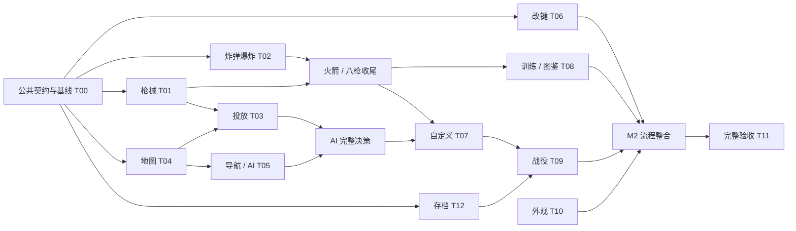

# 并行开发计划与任务看板

更新：2026-10-18（北京时间）。T00 已完成首批公共契约与本地基线；T01 已交付八枪（含加特林 / 重炮狙击枪两种终极）；T02 炸弹 / 爆炸、T03 投放、T04 四图与投放点、T05 基础 AI 战术、T10 多风格换装均已交付可玩子集；T08 训练 1—8 试枪已接。T00 记录见 [交付记录](./updates/2026-10-17-t00-contracts.md)，T01 见 [交付记录](./updates/2026-10-17-weapons.md)、[终极武器追加](./updates/2026-10-18-ultimate-weapons.md) 与 [弹匣换弹](./updates/2026-10-18-magazine-reload.md)，地图见 [适中难度交接](./updates/2026-10-18-moderate-map-difficulty.md)。

先读 [开发现状](./DEVELOPMENT.md)、[架构](./ARCHITECTURE.md) 和 [根目录协作约定](../AGENTS.md)。产品规则引用 [PRD](./PRD.md)；任务验收是增量条件，不能替代全量 A01—A30。各模块的独立任务文件见 [模块任务包](./modules/README.md)。

## 1. 协作方式

### 1.1 角色与文件归属

建议设置一个集成者和若干模块开发者。集成者负责公共接口、主流程接线和全量验收；模块开发者完成约定路径里的实际功能、测试与交接。

角色可以由同一个 AI 在不同阶段承担，也可以由多个 AI 同时承担；下列名称不是已经存在的负责人。

| 范围 | 单一写入负责人 | 其他任务如何接入 |
| --- | --- | --- |
| `src/game/core/types.ts` | 集成者 | 提交字段 / 事件 / 兼容方案；接口先合入后消费 |
| `BattleSimulation.ts`、`MatchRunner.ts`、`actors.ts`、`MatchSystem.ts` | 集成者 | 提供系统调用点、初始化 / 复活 / 加时 / 结算改动清单 |
| `src/app/GameApplication.ts`、`src/scenes/ArenaScene.ts` | 集成者 | 模块导出组件 / 服务 / 操作，由集成者装配 |
| `src/ui/GameUI.ts` | 集成者 | 新页面优先写为独立视图 / 组件，交付渲染与回调接口 |
| `src/style.css` | 集成者 | 新功能使用独立、有命名空间的样式文件，最后统一接入 |
| `src/storage/SaveStore.ts` | T12 负责人 | T06 / T07 / T09 / T10 提交字段和校验需求，不各自改版本 |
| `CombatSystem.ts`、`content/weapons.ts` | T01 负责人 | T02 通过独立爆炸服务协作，T03 通过武器切换入口协作 |
| `content/maps.ts`、`ArenaRenderer.ts` | T04 负责人 | T01 / T02 / T03 / T10 提交呈现接入清单；同文件子块仍需串行整合 |
| `BotController.ts` 及导航模块 | T05 负责人 | 消费冻结后的地图 / 武器 / 炸弹数据，仍只输出输入 |
| `KeyboardInput.ts`、`content/controls.ts` | T06 负责人 | T02 的投弹输入由双方按公共契约接入 |
| `content/matches.ts` | T07 负责人 | 战役和训练提供配置构造器，不重复改基础模式工厂 |
| `scripts/smoke.mjs`、测试配置、包依赖 | 集成者，T11 提供改动 | 各模块先新增独立测试文件；公共脚本串行合入 |
| 本文看板、开发现状 | 集成者汇总 | 开发者交付状态变更；不要同时覆盖整张表 |

`tests/weapons.test.ts` 等下文提及的新路径是建议交付位置，当前尚不存在。可按实际设计调整，但必须在领取记录中明确。

### 1.2 两种并行模式

**独立工作区（推荐）**：项目已有 T00 基线 commit（`332998d` / `1cc7358`），从该基线建立独立分支 / worktree。开发者使用各自端口和测试输出目录；以小提交 / 补丁交接，按依赖顺序整合并解决冲突。不要假定新工作区包含主目录未提交或被忽略的文件。

**共享工作区**：同一时刻一个文件只有一个写入者；公共文件由集成者串行改。读文件、运行单元测试通常可并行；安装依赖、写同一构建目录、写同一截图、更新锁文件需要协调。领取表只是协作记录，不能当作原子锁。

两种模式都应先确认任务和接口归属，避免模块完成后才发现类型、时间或状态顺序不同。不要在同一个目录里由多个 AI 同时切换分支。

### 1.3 任务状态

| 状态 | 含义 |
| --- | --- |
| 待领取 | 尚无负责人；依赖可能仍未完成 |
| 进行中 | 有负责人、工作区、文件范围与明确依赖 |
| 待集成 | 模块自身完成，公共接线尚未进入主流程 |
| 待验收 | 已接入，尚有约定检查未完成 |
| 已完成 | 实际可用、依赖已接入、检查有证据、文档同步 |
| 部分完成 | 可用子集已交付；原任务仍有依赖其他系统的工作，见任务包未勾选项 |
| 阻塞 | 记录具体依赖与需要谁提供什么，不能只写“等接口” |

每条任务记录：负责人、工作区 / 分支、基线 commit、当前状态、修改时间、下一步。没有填写负责人就不能视为已经派发。下面的总看板是认领状态与负责人的唯一记录；独立模块文件保存范围和子任务，不另建第二套状态表。

## 2. 公共契约：先明确，再并行

下表是 T00 已冻结的首批契约；标为“待……”的行仍是设计方向，不是已存在 API。字段已在 `src/game/core/types.ts` 落地并有消费方或测试，后续任务按此接入。

| 契约 | 最小需求 | 必须协调的消费者 |
| --- | --- | --- |
| 武器实例（已冻结） | `WeaponDefinition.maxAmmo: number \| null`（null 无限）；`WeaponInstance { definition, ammoRemaining }`；`ActorState.weapon`；`MatchConfig.startingWeapon`；冷却留在 `ActorState.fireCooldown`，切枪不重置 | 战斗、生成 / 复活 / 加时、HUD；T01 补注册表 / 有限弹 / 耗尽回退；T03 换枪；T07 配置 |
| 弹丸（已冻结） | `Projectile.weaponId`、`velocity: Vec2`、`impulse: Vec2`、`distanceRemaining`；发射时冻结数值，换枪不改在途弹丸 | 战斗、扫掠碰撞、渲染、测试；T01 二维 / 霰弹；T02 火箭 |
| 投弹输入（已冻结） | `ActorInput.bombPressed`（按下边沿），`idleInput` / 键盘 / AI 默认 false；连续射击语义不变 | `idleInput`、键盘、AI、运行器、输入测试；T02 消费，T06 接 K / 小键盘 1 前保持不显示可用 |
| 炸弹 / 爆炸（签名已冻结） | `ExplosionSource`、`ExplosionRequest { ownerId, source, center, radius, centerImpulse, edgeImpulse }`、`ExplosionHit { actorId, impulse }`、`ExplosionResolver.resolve(state, request)` | T02 实现共享计算 / 引信 / 遮挡；T01 火箭消费；核心调度、归因、AI、音效、渲染、重置 |
| 箱子与投放（待 T03） | 地图点位、预告 / 落地状态、寿命、武器池 / 权重、确定性抢箱 | 地图、投放、武器切换、AI、渲染、自定义 |
| 配置 / 模式（部分冻结） | 已冻结 `startingWeapon`、`matchId`；地图 / 武器 ID 校验、玩家槽位、难度、训练 / 自定义 / 战役语义仍待 T07 | 工厂、构造器、UI、结果统计、存档 |
| 存档（待 T12） | v1 兼容、键位 / 教学 / 外观 / 战役字段、迁移、结果 ID 历史；当前 `SaveStore` 只记 `lastResultId` | 设置、模式、战役、结算、清档 |
| 视图集成（边界已冻结） | `GameUI` 主壳与对话框由集成者维护；T06 交付独立设置组件；视图只发回调，不直接写 localStorage；应用层统一保存 | 主 UI、应用层、设置 / 外观 / 地图 / 战役页面 |

不要为所有未来系统一次性添加未使用字段。T00 先冻结首批真实消费接口，后续按任务补充；每次记录接口变更及影响方。

### 2.1 逻辑顺序约定（T00 冻结）

当前实现：生命周期计时 → 移动 → 子弹 → 批量出界 → 胜负。T00 冻结新增系统的插入点，未实现项在括号中标注归属：

1. 倒计时 / 暂停 / 结算先过滤；只有正式逻辑时间推进引信、投放和寿命。
2. 更新复活 / 保护计时，处理输入与移动。
3. 发射与推进子弹、炸弹和引信，计算该帧所有有效推力；爆炸服务只返回命中与推力，由调度统一应用。（炸弹 / 爆炸 T02）
4. 批量确认全部出界，不能在确认前让已经出界的角色拾取箱子。
5. 处理合法拾取；该帧已发射的攻击仍属于旧枪，新枪最早下一步使用。拾取不能复活已出界角色，同帧只发给一个角色。（投放 T03）
6. 全部出界完成后统一决定胜负；若本帧结束对局，不再生成可见的新投放或执行后续局内操作。
7. 加时、重赛和训练重置清理弹丸 / 炸弹 / 箱子 / 预告 / 计时，并从 `MatchConfig.startingWeapon` 恢复武器与弹量；重赛通过新配置和新运行器完成，不继承旧局状态。

投放预告与落地具体插入点、拾取与箱子到期同帧的优先级，由 T03 在系统接入前补充明确测试；T00 只冻结“出界结算之后、胜负之前”的顺序，不替 T03 决定同帧细节。

### 2.2 随机与结果标识

相同种子、配置与输入应可复现 AI 和投放；不同用途的随机流应避免因新增一个视觉效果就改变玩法随机。表现层随机不能决定命中或掉落。

对局唯一 ID 独立于玩法种子。`GameApplication` 每局生成 `matchId` 并放入 `MatchConfig`；`MatchSystem` 优先用 `config.matchId` 写 `MatchResult.id`，缺省仍回退到旧的 `seed-mode` 以兼容测试 / 旧调用。T12 负责存档中的最近结果与交错重复去重范围；当前 `SaveStore` 仍只保存 `lastResultId`，不能宣称完整历史去重。

## 3. 总看板

所有“待领取”是本次快照，不代表任务依赖已满足。建议并行度只用于安排文件，不承诺时间。

| ID | 任务 | 阶段 / 优先级 | 开发前依赖 | 当前状态 / 负责人 |
| --- | --- | --- | --- | --- |
| T00 | Git 基线、首批公共契约与集成准备 | M1 前置 | 当前原型 | 已完成 / 当前会话（2026-10-17，基线 332998d / 1cc7358） |
| T01 | 武器实例、弹匣 / 备弹、八类枪（含终极） | M1 高 | T00 武器 / 弹丸契约已提供；火箭依赖 T02 爆炸服务 | 核心完成 / 当前会话（八枪、重炮一枪击出、加特林弹匣、换弹已交付） |
| T02 | 炸弹、爆炸、遮挡、自伤 | M1 高 | T00 输入 / 爆炸契约已提供；T01 已留火箭消费点 | 核心完成 / 当前会话 |
| T03 | 武器箱投放与自动拾取 | M1 高 | T01 换枪入口、T04 投放点、T00 调度 / 随机 | 核心完成 / 当前会话（四图投放点、拾取、HUD / 音效） |
| T04 | 地图注册与古城 / 都市 / 飞船主题 | M1 高 | 投放点对齐 T03，完整导航图由 T05 完善 | 已完成当前地图范围 / 适中难度、投放点、内侧失足恢复与外围击出已验收（D:\Code\gun-brawl / main） |
| T05 | AI 平台导航与三档决策 | M1 高 | 可先做现有地图导航；完整验收依赖 T01—T04 | 部分完成 / 当前会话（射程、抢箱、投弹 / 威胁规避；完整导航待续） |
| T06 | 自定义键位与设置子视图 | M2；可提前并行 | T00 设置 / 输入边界已冻结；持久化接入 T12 | 功能完成 / 当前会话（改键 / 冲突 / 恢复默认 / 刷新保留；独立组件未拆） |
| T07 | 自定义对局、配置校验与 UI | M1 高 | T00 已冻结 `startingWeapon` / `matchId`；完整接入 T01 / T03 / T04 / T05 / T12 | 核心完成 / 当前会话（2—4 人、逐 AI 难度、规则 / 武器池、最近配置；完整 4 人淘汰验收待 T11） |
| T08 | 训练教学、试枪与图鉴 | M2 | T01 八枪已提供；投放重置依赖 T03；教学保存依赖 T12 | 核心完成 / 当前会话（六任务、移动假人、重置、图鉴、1—8；首次引导 / 图鉴返回待续） |
| T09 | 六关战役、解锁、成绩 | M2 | T01—T05、T07 配置能力、T12 | 核心完成 / 当前会话（六关、独立配置、解锁、最佳成绩、结果页下一关 / 重试 / 选关；人工平衡验收待续） |
| T10 | 多风格外观编辑与角色重绘 | M2 | 箱子 / 炸弹 / 八枪表现依赖 T01—T03 | 部分完成 / 角色精修会话（五人重绘、22 帧动作、连射跑动与握持已验收；专属双手握持 / 换弹、附件惯性与动作预览待续） |
| T11 | 增量回归、完整验收、性能 / 资源 | 全阶段；发布门槛 M3 | 可立即做基线清单；完整验收依赖对应功能 | 待领取 / — |
| T12 | 存档扩展、迁移、清档与结果去重 | M1—M2 | T00 已提供 `matchId` 结果接入点；战役字段依赖 T09 | 核心完成 / 当前会话（v2 迁移、清档、20 条历史去重；战役字段待 T09） |

本轮执行记录：T00 在 `D:\Code\gun-brawl` 完成，基线为 `332998d`，文档同步为 `1cc7358`；Git HEAD 已建立并已推送 GitHub。负责人同时承担地图 / 外观集成：独占修改地图配置、角色绘制、地图背景、外观 / 地图选择子视图；统一接入类型、场景、主 UI、应用与保存。用户新增需求优先于旧的双塔 / 断桥规划。T00 首批契约已落地，其他任务按上表接入；T12 只接入兼容旧档的外观与地图字段，其他存档工作仍待领取。

已落地契约：`CharacterAppearance` / `ActorConfig.appearance?`、地图可选主题元数据、`createMatchConfig(mode, seed, selections?)` / `createCustomMatchConfig(settings, seed, selections?)`、`CustomMatchSettings` / `validateCustomMatch`、`MatchConfig.dropMode`、`selectedMapId` / 两玩家 `appearances` / `customMatch`（继续 v1）；T00 新增 `WeaponInstance` / `ActorState.weapon` / `MatchConfig.startingWeapon`、`Projectile.weaponId` / `velocity` / `impulse`、`ActorInput.bombPressed`、`ExplosionRequest` / `ExplosionHit` / `ExplosionResolver`、`MatchConfig.matchId`。主 UI 的换装 / 选图回调由应用统一保存，当前对局保持创建时配置。T05 仅补充基于地图的下层恢复与跳跃落点，完整导航未实现。上述公共文件接线已结束，可由后续负责人继续；不要再按旧的“写死训练台”假设修改。

T09 执行记录：新增六关战役配置与独立 `campaign` 模式；关卡选择、线性解锁、锁定禁用、最佳成绩（剩余生命优先、耗时次之）、胜 / 平 / 负独立提交、结果页下一关 / 重试 / 选关已接入；战役不计普通人机场次。4 项战役测试 + 浏览器关卡选择 / 开局通过，172 项 / 17 文件通过。详见 [战役交付](./updates/2026-10-18-campaign.md)。

T12 执行记录：存档升 v2 但保留 `gun-brawl:save:v1` key，v1 逐字段迁移；新增最近 20 条结果窗口去重、设置页确认清档、清档后应用默认键位 / 音量 / 外观并回菜单。172 项 / 17 文件通过；浏览器清档确认、toast 与默认值实测通过。战役字段已由 T09 接入。详见 [存档迁移交付](./updates/2026-10-18-save-migration.md)。

T08 执行记录：训练台新增六项任务、移动 / 静止假人、局部重置和八枪图鉴；任务只由合法输入 / 事件推进，完成标记写入 v1；图鉴可直接预选武器进入训练。浏览器实测移动 / 二段跳 / 穿台 / 投弹 4/6、假人切换与重置通过；训练固定使用训练台。172 项 / 17 文件通过。详见 [训练与图鉴交付](./updates/2026-10-18-training-expansion.md)。首次引导、显式跳过、图鉴返回保留仍待。

T07 执行记录：菜单新增自定义对局；共享配置校验器与 2—4 人构建器；最多两名本地玩家、逐 AI 难度、地图、1—9 命、30—600 秒、全部 / 仅标准 / 关闭投放；配置页实时错误并禁用开始；最近配置写入 v1 存档，重赛继续使用实际配置。6 项配置测试与浏览器 4 人 HUD 通过；完整 4 人淘汰 / 观战 / 加时验收待 T11。详见 [自定义对局交付](./updates/2026-10-18-custom-match.md)。

T06 执行记录：两名玩家 7 个动作的改键、冲突 / 保留键校验、Esc 取消、恢复默认、即时生效与刷新保留已接入设置面板；`SaveData.bindings` 写入现有 v1 存档，旧档 / 损坏档回退默认。150 项 / 14 文件通过；浏览器实测 P1 开火改 U 后 J 失效、U 正常扣弹。详见 [改键交付](./updates/2026-10-18-keybindings.md)。独立录键组件与手柄仍未拆 / 未接。

T01 执行记录：在 `D:\code\gun-brawl` 同一工作区交付八枪（六标准 + 加特林 / 重炮狙击枪）、注册表、有限弹 / 耗尽回退、霰弹五弹道、火箭爆炸、重炮单发冲量上限、HUD / AI 射程读取；最终 150 项 / 14 文件通过（含弹匣 / 备弹 / 换弹与改键）。详细参数与限制见 [T01 交付](./updates/2026-10-17-weapons.md)、[终极武器追加](./updates/2026-10-18-ultimate-weapons.md) 与 [弹匣换弹](./updates/2026-10-18-magazine-reload.md)。

T04 布局优化记录：从 `1cc7358` 在 `D:\Code\gun-brawl-map-layouts-20261017` / `codex/map-layouts-20261017` 隔离开发；三个子代理分别负责地图配置、WorldArt 和新增路线测试，主代理负责选图、菜单站位、浏览器验收和文档。古城双塔庭院、都市非对称屋顶、飞船反应堆枢纽已按改动块接入主工作区 `3ab2aa5`，保留 T00 / T01 并行成果。集成后 79 项测试 / 7 文件、构建和两套浏览器流程通过；每出生点独立探索所有平台，六种 AI 气闸恢复通过。详见 [布局优化交接](./updates/2026-10-17-distinct-map-layouts.md)。2026-10-18 用户授权将两轮地图改动统一提交并推送 `main`。

T04 击出节奏追加：用户确认“更容易掉下去，加快淘汰节奏”。在主工作区继续，几何代理独占 `content/maps.ts`，美术代理独占 `WorldArt.ts`，验证代理独占新增 `tests/map-combat.test.ts` 和既有路线测试；主代理负责菜单站位、选图提示、浏览器与交接文档。训练台保持手感基线；主题图减少底部兜底覆盖，要求持续命中能造成击出，同时保留主动跳跃互达。

T04 追加验收完成：古城 / 都市 / 飞船中央底台收窄到 260 / 260 / 200，六处内侧场景的对手全程向内回跑，3 次手枪命中在 1.30–1.40 秒内击出扣命，单发可回台；全平台合法互达 / AI 气闸恢复仍过。地图专项 39 项通过；并行爆炸 / 火箭接入后全套 107 项 / 9 文件通过；2026-10-18 提交前联合验证 127 项 / 12 文件、构建通过，浏览器与差异检查见 [淘汰节奏交接](./updates/2026-10-17-map-knockout-pace.md)。本次按用户授权提交并推送 `main`。

T04 适中难度迭代（2026-10-18，已验收）：用户试玩反馈“地图还是太容易掉下去了，难度适中一点”，取代上一轮以快速坠落为目标的验收。当前会话串行调整三张主题图的落脚区与下层接应，底台宽改为 560 / 620 / 580；保留训练台、运动物理和武器参数。六处内侧失足可落到下层并普通跳回、三处穿台接应、六处外围持续击出 / 单发救回、逐出生点路线和 AI 气闸恢复均通过；兼容并行投放点，都市管道候选点同步降到 y585。全套 150 项 / 14 文件、构建、两套浏览器流程通过，三图截图已检查。详见 [适中难度交接](./updates/2026-10-18-moderate-map-difficulty.md)。

### 3.1 T00 / T01 接入清单

T10 角色精修追加（2026-10-18，已验收当前范围）：用户确认直接完成第一轮五角色重绘并留下后续方案。工作区 `D:\Code\gun-brawl` / `main`；角色绘制拆为 `CharacterPainter`、`CharacterMotion` 与 `CharacterArt`，接入 22 帧姿态和稳定握持 / 后坐，连续开火不覆盖运动帧。110 个帧与 150 种混搭检查、5 项动作回归通过；联合 172 项 / 17 文件、构建与两套浏览器流程通过。保留碰撞体、地图、武器和并行改键 / 自定义对局成果。后续 C03—C07 的范围与并行边界见 [角色设计方案](./CHARACTER_DESIGN.md)，文件和证据见 [精修交接](./updates/2026-10-18-character-polish.md)。

| 任务 | 直接消费 | 仍需完成 / 不要假设 |
| --- | --- | --- |
| T01 | `ActorState.weapon.definition` / `ammoRemaining`、`MatchConfig.startingWeapon`、`Projectile.weaponId` / `velocity` / `impulse` / `impulseCap` | 八枪、注册表、有限弹扣减 / 耗尽回退、霰弹二维弹道、火箭爆炸、重炮一枪击出、HUD / AI 读取已交付；`fireCooldown` 继续留在角色上，切枪不要清零 |
| T02 | `ActorInput.bombPressed`（默认 false）、`ExplosionResolver` / `ExplosionRequest` / `ExplosionHit` | 实现共享爆炸计算、炸弹 / 引信 / 遮挡 / 自伤、事件与清理；键盘投弹键由 T06 接，未接入前不得显示为可用 |
| T03 | `createWeaponInstance` / 换枪入口、`Projectile` 快照、`MatchConfig.startingWeapon` | 地图点位、8 秒投放、预告 / 落地 / 到期、同帧拾取裁定；拾取顺序固定在批量出界之后、胜负之前 |
| T06 | `ActorInput.reloadPressed` / `bombPressed` 契约、设置视图边界 | 默认 P1 R / K、P2 小键盘 2 / 1；设置面板只回调应用，不直接写 SaveStore / localStorage；实际映射存入 `SaveData.bindings` |
| T07 | `MatchConfig.startingWeapon` / `matchId` | 其余配置字段、槽位 / 难度 / 武器池校验、自定义页面；不要改 `GameMode` 或存档版本 |
| T12 | `MatchResult.id`（`matchId` 优先，旧 `seed-mode` 回退） | 最近结果 / 交错重复去重范围、存档字段与迁移；当前只保存 `lastResultId`，不是完整历史 |

T00 验收检查：`pnpm typecheck`、48 项 `pnpm test`、`pnpm build`、`pnpm test:browser` 均通过；浏览器 smoke 覆盖三模式、默认键位、暂停 / 恢复、失焦、设置、双人、重赛、刷新和禁用存储。T00 不包含推送远端；本次契约只做本地提交。

T01 验收检查：150 项 `pnpm test` / 14 文件、`pnpm build` 通过；八枪注册表 / 弹匣 / 备弹 / 换弹 / 霰弹 / 火箭爆炸 / 重炮一枪击出 / 加特林弹带 / 耗尽回退 / AI 射程有自动化覆盖。正常对局仍从手枪开始，箱子从第 8 秒提供特殊枪。

## 4. 建议并行批次



- **准备期**：T00 确认接口与基线。其他开发者可读代码、列测试、设计地图 / 导航，不独立落公共类型。
- **第一批**：枪械核心、地图 / 绘制、改键组件、存档迁移可按归属并行。AI 可单独开发纯导航算法。炸弹核心在契约明确后也可开始，但不能与枪械负责人同时改战斗文件。
- **第二批**：投放与拾取、爆炸 / 火箭收尾、导航整合、配置页。集成者串行接入类型、调度、主 UI 和 HUD。
- **第三批**：训练 / 图鉴、战役、外观。各自拥有独立组件与配置；共享存档和角色渲染仍由负责人整合。
- **每批验收**：各模块先验证自身，集成者再运行完整测试 / 构建 / 浏览器流程。T11 从第一批起积累场景，不等产品末期才检查。

即使有很多 AI，也不要把 `types.ts`、`GameUI.ts`、`ArenaRenderer.ts` 分给多人同时改。核心时序和集成工作需要串行，不靠增加并行数量解决。

## 5. 独立模块任务包

任务卡已按模块拆到 docs/modules/，本计划保留统一认领、依赖与集成约定。下列文件是模块范围与验收的唯一详细说明，避免任务卡在多个文件中重复维护。

| ID | 独立模块说明 | 子任务 |
| --- | --- | --- |
| T00 | [公共契约与可复用基线](./modules/00-integration.md) | 详见模块文件的 T00.1—T00.5 |
| T01 | [武器实例与八类枪械](./modules/01-weapons.md) | 详见模块文件的 T01.1—T01.6 |
| T02 | [炸弹与爆炸](./modules/02-explosives.md) | 详见模块文件的 T02.1—T02.5 |
| T03 | [投放、箱子与拾取](./modules/03-drops.md) | 详见模块文件的 T03.1—T03.5 |
| T04 | [地图注册与四张主题地图](./modules/04-maps.md) | 详见模块文件的 T04.1—T04.5 |
| T05 | [平台导航和三档 AI](./modules/05-ai.md) | 详见模块文件的 T05.1—T05.5 |
| T06 | [改键、冲突检测与设置组件](./modules/06-controls.md) | 详见模块文件的 T06.1—T06.5 |
| T07 | [自定义对局与配置校验](./modules/07-match-setup.md) | 详见模块文件的 T07.1—T07.5 |
| T08 | [教学训练与武器图鉴](./modules/08-training-encyclopedia.md) | 详见模块文件的 T08.1—T08.5 |
| T09 | [六关战役与成绩](./modules/09-campaign.md) | 详见模块文件的 T09.1—T09.5 |
| T10 | [外观编辑与表现补齐](./modules/10-appearance.md) | 详见模块文件的 T10.1—T10.5 |
| T11 | [全量回归、兼容、性能与资源](./modules/11-quality.md) | 详见模块文件的 T11.1—T11.5 |
| T12 | [存档、迁移与结果标识](./modules/12-save-data.md) | 详见模块文件的 T12.1—T12.5 |

入口和分发方式见 [模块目录](./modules/README.md)。每个模块有 5 个子任务和可复制的开发指令；T04 / T10 已按新需求落地子集，接手时先看勾选项和本轮交付记录。

## 6. 任务交接模板

领取和交付均使用任务 ID，避免只写“武器做完了”。下面模板可以复制到任务会话或独立交接记录中。

```text
任务 ID / 名称：
负责人 / 会话标识：
状态：待领取 / 进行中 / 待集成 / 待验收 / 部分完成 / 已完成 / 阻塞
基线 commit：
工作区绝对路径 / 分支：
已约定的独占文件：
公共文件接入请求及集成负责人：
依赖的接口版本 / 任务：

本次实际完成的行为：
变更文件 / 提交或补丁：
新增或变更接口、默认值、事件：
初始化 / 复活 / 加时 / 重置 / 存档影响：
已运行命令、环境与结果：
浏览器入口 / 复现步骤 / 截图：
尚未完成的行为和已知限制：
集成者需要接入的位置：
下一步 / 阻塞解除条件：
更新日期（北京时间）：
```

## 7. 集成与完成标准

1. 核对任务文件范围、依赖和公共接口；有冲突先解决类型 / 生命周期，再接 UI。
2. 合入核心 / 内容和测试，保留原有三模式、默认手枪手感与键位。
3. 接入运行器、生成 / 复活 / 加时 / 重置；新增状态有明确清理路径。
4. 接入渲染 / 音效 / HUD / 页面 / 保存；入口只展示可运行功能。
5. 运行相应测试和 `pnpm build`。涉及玩法流程、输入或 UI 时运行浏览器检查；性能目标使用单独实测。
6. 检查 A01—A30 中对应条目并记录缺口。未覆盖的场景明确待验收。
7. 更新 [开发现状](./DEVELOPMENT.md)、本任务状态、必要的 README / 架构 / PRD；保留交接证据。

M1 完成前必须把八枪 / 炸弹 / 投放 / 四图 / AI / 自定义联通；M2 完成前补齐教学 / 战役 / 外观 / 图鉴 / 设置 / 存档；M3 才对用户体验与性能作交付结论。不要把模块单测通过当作整个阶段完成。
