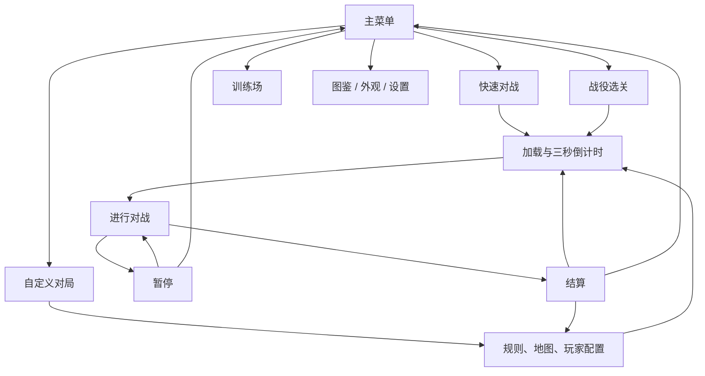

# 混枪大乱战：产品需求文档

| 项目 | 内容 |
| --- | --- |
| 版本 | v0.1，研发评审稿 |
| 日期 | 2026-10-17（北京时间） |
| 产品名称 | 混枪大乱战，暂定 |
| 参考玩法 | Gun Mayhem 系列的横版平台射击、击退出界、生命淘汰和本地乱斗 |
| 首版平台 | 桌面浏览器 H5，键盘操作；本次采用的设计假设 |
| 工程现状 | 项目已建于 `D:\Code\gun-brawl`，已有核心可玩原型；实际已完成 / 未完成以[开发现状](./DEVELOPMENT.md)为准，本文仍描述完整目标 |
| 事实依据 | [功能调研与来源](./RESEARCH.md)，主要采用其中 S01—S04 |
| 数值性质 | 所有地图数量、关卡数量、物理参数、武器参数和指标均为本产品建议，待原型验证 |

## 1. 产品定位与设计目标

做一款打开即可玩的卡通平台射击乱斗游戏。玩家在多层平台上移动、跳跃，争抢武器，利用枪械和爆炸的推力把对手打出场地，同时争取返回平台的机会。每个角色有有限生命，最后仍有生命的参战者获胜。

核心体验是“走位—争夺射击角度—击退—追击或返回平台—重赛”。局内角色能力和武器差异要让人容易理解，胜负主要由操作、位置和局内选择决定。

首版需要验证三个问题：新手能否理解“出界掉命”；移动、跳跃与击退是否形成有趣的对抗；单人对 AI 和同屏双人是否能让玩家愿意连续重赛。

### 1.1 参考事实与本产品方案

- 参考游戏已核实的功能：击出场外、有限生命、AI、最多四名本地玩家、战役、自定义对局、角色外观、枪械和特长；不同版本覆盖情况见调研表。
- 本文定义的首版方案：桌面 H5、1—2 名人类玩家、最多 4 名参战者、四张地图、六类基础枪械 + 两类终极武器、六个战役关卡和训练场。2026-10-17 用户追加古城 / 都市 / 飞船主题与多风格换装；2026-10-18 追加加特林 / 重炮狙击枪并重调威力，地图与武器范围按下文更新；完整进度仍以 DEVELOPMENT 为准。
- 当前不做网络匹配、排位、账号、商城、付费数值成长、广告和手机触控。后续若需要，应单独补充房间、网络状态、操作和商业化需求。
- 本地四人是参考系列能力；本产品首版只承诺本地双人，3—4 名人类玩家放入下一阶段。

## 2. 用户与体验目标

| 用户 | 使用场景 | 需要解决的问题 |
| --- | --- | --- |
| 怀旧休闲玩家 | 一个人打开网页玩几局 | 快速进入游戏，理解规则，AI 难度合适 |
| 同屏双人玩家 | 两人共用一台电脑 | 键位清晰、角色容易区分、重赛方便 |
| 操作型玩家 | 练习跳跃、不同武器和高难 AI | 操作一致，击退反馈清楚，难度公平 |

### 2.1 首轮可用性验证目标

以下是提议的验证门槛，不是已获得的运营数据。先邀请至少 10 名首次体验者做观察测试，并单独记录双人体验问题。

| 指标 | 建议目标 | 口径 |
| --- | --- | --- |
| 理解胜负 | 至少 8/10 人在教学后正确说出出界与生命规则 | 不由观察者提示答案 |
| 进入首局 | 首屏可操作后 45 秒内进入快速对战 | 包含找入口与倒计时，不包含网络加载 |
| 基础操作 | 至少 8/10 人完成移动、二段跳、穿台、开火和投弹任务 | 训练场任务全部完成 |
| 对局时长 | 默认规则的多数对局在 90—210 秒内结束 | 以至少 20 局原型记录调参；极端短局仍允许 |
| 重赛意愿 | 至少 6/10 人主动选择再次对战 | 观察者不引导重赛 |
| 规则一致 | 验收表中的生命、平局、暂停用例全部通过 | 属于发布门槛，不以平均值代替 |

## 3. 功能范围与优先级

P0：首个可交付版本必须具备；P1：基础体验验证后增加；P2：独立规划。下表描述产品目标，部分能力已有原型；实现状态见[开发现状](./DEVELOPMENT.md)，开发拆分见[并行计划](./PARALLEL_PLAN.md)。

| ID | 模块 | P0 范围 | P1 / P2 |
| --- | --- | --- | --- |
| F01 | 主菜单与快速对战 | 一键进入 1 人对 1 AI；首次教学入口 | 最近配置快捷入口 |
| F02 | 移动与平台 | 左右移动、转向、二段跳、单向平台穿台 | 移动平台、特殊地形 |
| F03 | 攻击与击退 | 朝向射击、炸弹、后坐力、击退反馈 | 特殊弹道、更多副武器 |
| F04 | 生命与胜负 | 出界、复活、保护、淘汰、超时、平局 | 团队模式规则 |
| F05 | 枪械 | 六类基础枪 + 两类终极武器、弹量、武器图鉴 | 17 个具体型号、弹匣 / 换弹 |
| F06 | 地图 | 训练台、云上古城、霓虹天际、星际方舟四张静态地图 | 更多地图、环境机关 |
| F07 | 武器投放 | 固定点位池、提示、自动拾取、随机武器 | 强化道具、投放自定义 |
| F08 | AI | 简单、普通、困难三档 | 更多风格或合作任务 |
| F09 | 自定义对局 | 1—2 名人类，总参战 2—4 人；地图、生命、时限、AI、武器池 | P1：3—4 名人类、特长；P2：网络房间 |
| F10 | 战役 | 六个递进关卡、线性解锁、完成记录 | 更多关卡、剧情、挑战模式 |
| F11 | 训练场 | 教学任务、试枪、重置，不计战绩 | 独立挑战与星级评分 |
| F12 | 角色外观 | 颜色、帽子、衣服、预览；无战斗属性 | 更多外观、收藏展示 |
| F13 | 设置与暂停 | 改键、音量、震动强度、失焦暂停 | 手柄、手机触控适配 |
| F14 | 本地存档 | 设置、外观、战役进度、基本统计 | P2：账号和跨设备存档 |
| F15 | 结算与重赛 | 胜负、关键统计、重赛、返回配置 | 回放、分享 |

## 4. 信息架构与主要流程

主菜单入口：快速对战、战役、自定义对局、训练场、武器图鉴、角色外观、设置。

### 4.1 快速对战

主菜单点击“快速对战” → 若从未完成教学，显示可跳过的规则卡并提供“先练习” → 按固定默认配置加载 → 3、2、1 倒计时 → 对战 → 结算 → 再来一局。

默认配置：1 名玩家、1 名普通 AI、地图“云上古城”（之后使用上次选择）、各 3 条生命、180 秒时限；全量版允许八类枪（含两类终极）投放。当前正常对局从基础手枪开始，8 秒后可从箱子获得特殊枪 / 低概率终极武器；首次引导不在之后每次进入时重复弹出。

### 4.2 自定义对局

同一配置页完成规则、地图与玩家槽位配置；点击“开始对战”前检查有效性，问题直接显示在对应字段旁。结束后“修改配置”保留上一次选择，“再来一局”保留规则但重新生成投放序列。

### 4.3 战役

选关 → 查看目标与对手 → 开始 → 成功时写入进度并解锁下一关；失败可立即重试。战役不要求先购买或升级武器。

## 5. 对局与生命规则（F04）

### 5.1 对局默认参数

| 参数 | 建议默认值 | 自定义范围 / 说明 |
| --- | --- | --- |
| 总参战人数 | 2 | 2—4，至少 1 名人类 |
| 本地人类人数 | 1 | P0 为 1—2；其余槽位为 AI 或关闭 |
| 每人初始生命 | 3 | 1、3、5，所有参战者相同 |
| 常规时限 | 180 秒 | 120、180、300 秒；P0 不提供无限时 |
| 开局倒计时 | 3 秒 | 固定，期间角色不能行动 |
| 复活等待 | 1 秒 | 仅在仍有剩余生命时触发 |
| 复活保护 | 1.5 秒 | 主动开火或投弹立即结束保护 |
| 加时 | 最多 30 秒 | 只在常规时间结束且最高生命数相同情况下触发 |

### 5.2 出界与复活

1. 枪弹命中产生击退，不直接扣除生命；P0 不设血条、护甲或累计伤害百分比。
2. 角色碰撞体完整越过任一淘汰边界才算出界；边界与可见画面之间留有缓冲，短暂离开画面但仍在界内时可尝试返回。
3. 每次出界只扣 1 条生命。剩余生命大于 0 时进入复活等待；等于 0 时进入观战，不再接受战斗操作。
4. 复活重置位置、速度、跳跃次数、当前枪械为基础手枪，以及炸弹数量；仍有生命的等待复活者也属于未被淘汰的参战者。
5. 出生点从地图预设点选择：优先选择距离敌人超过 300 逻辑像素的点；无满足点时，选择与最近敌人距离最大的安全点。不得在平台外或角色重叠处生成。
6. 保护期间有轮廓闪烁和剩余时间提示，不受子弹或爆炸推力影响；可以移动、跳跃、拾枪。主动攻击先解除保护，再处理本次攻击。
7. 已投出的子弹和炸弹可在拥有者出界后继续存在，直到自然消失或对局结算；拥有者淘汰不撤销此前合法攻击。

### 5.3 胜负、超时与同时淘汰

- 每个逻辑帧先统一处理命中、爆炸和所有出界，再评估胜负。不能处理完第一名角色就提前结算。
- 仅一名参战者剩余生命大于 0：该参战者获胜，即便他仍在复活等待状态。结算立即停止物理与攻击，后续残留攻击不再改变结果。
- 同一逻辑帧所有参战者生命都变为 0：平局。
- 常规时间结束：先处理该帧出界，再比较剩余生命；唯一最高者获胜，击出数不作为次级胜负条件。
- 多人并列最高生命：只让并列者进入加时，其余观战；并列者各重置为 1 条生命、基础手枪和初始炸弹，返回安全出生点，重新倒计时并给予正常保护。
- 加时持续投放武器；30 秒内剩一人即获胜，所有人同帧淘汰或加时结束仍有多人则平局，不继续无限加时。
- 最后一名人类被淘汰后，AI 之间继续对战至结算；界面保留观战提示和暂停退出入口。

### 5.4 击出归因与统计

角色出界前 5 秒内受到的最后一次有效敌方击退，决定“击出”归属。没有有效敌方命中则记为自身失误；自身爆炸不产生自己的击出数，也不覆盖此前有效敌方归因。命中复活保护不算有效击退。归因仅影响展示，不影响生命扣除和胜负。

## 6. 操作、移动与战斗（F02、F03）

### 6.1 首版默认键位

| 动作 | 玩家 1 | 玩家 2 |
| --- | --- | --- |
| 左 / 右移动 | A / D | ← / → |
| 跳跃 / 空中第二次跳跃 | W / 空格 | ↑ |
| 向下穿过单向平台 | S | ↓ |
| 射击 | J | Enter / 小键盘 0（小键盘 Enter 也可） |
| 投弹（规划，原型尚未实现） | K | 小键盘 1 |
| 暂停 | Esc | Esc，共用 |

所有战斗动作可在设置中重绑。玩法采用左右朝向射击，不使用鼠标自由瞄准；改变水平移动方向即改变朝向，无水平输入时保留上次朝向。

长按射击按当前枪械射击间隔持续开火；跳跃和投弹只响应按下的瞬间，不能因为长按或键盘重复事件连续触发。左右同时按住时水平目标速度为 0；跳跃与穿台同帧按下时穿台优先。

### 6.2 移动手感与碰撞

首轮原型使用 1280 × 720 逻辑画面，渲染可缩放，物理速度不随实际分辨率变化。以下为调参起点：

| 参数 | 初始建议 |
| --- | --- |
| 角色碰撞体 | 宽 36、高 52 逻辑像素 |
| 水平最大主动速度 | 300 像素 / 秒 |
| 水平加速至最大速度 | 约 0.12 秒 |
| 地面松键停止 | 约 0.10 秒，保留单独击退速度的衰减 |
| 重力 | 1800 像素 / 秒² |
| 第一跳 / 第二跳起跳速度 | 向上 720 / 620 像素 / 秒 |
| 离开平台后仍可起跳的宽限 | 100 毫秒；使用地面起跳额度 |
| 落地前跳跃输入缓存 | 100 毫秒 |
| 击退外力速度上限 | 900 像素 / 秒；仅对外力分量的水平、竖直合成速度限幅 |
| 击退外力衰减 | 每 0.3 秒减半，按经过时间计算，不按渲染帧数计算 |
| 单向平台穿台 | 仅忽略当前平台 200 毫秒，下一层照常碰撞 |

落地恢复两次跳跃额度；离地后未使用地面起跳且超过宽限，仅保留一次空中跳。二段跳重设向上速度，不叠加成无限上升；按键必须释放后重新按下才能再次跳。

平台包括单向平台与实体地形两类。单向平台允许从下方穿过、从上方落地；实体地形阻挡角色和普通子弹。角色之间不发生实体推挤，避免堵路和复活重叠卡死。

主动移动速度与击退外力分开计算，不能每帧用主动最大速度把外力直接截断；落地取消向下速度，水平外力继续衰减。这样既保留玩家反向移动的救场机会，也避免按住方向键就完全抵消击退。

### 6.3 射击、后坐力与命中

- 子弹从枪口沿角色朝向水平发射；霰弹有固定扇形散布，首版不增加随机瞄准偏移。
- 普通弹只命中第一个有效角色或实体地形，不能穿过实体掩体；单向平台不挡弹。
- 命中产生水平击退和少量向上推力，给出闪光、声音和受击动作；角色仍可输入移动和跳跃，不做长时间锁定控制。
- 武器后坐力作用于持枪者，方向与发射方向相反；开火可能让靠近边缘的玩家失去平衡。
- 基础手枪无限弹；捡到的枪有有限总弹量，P0 没有换弹键和手动武器切换。打空后自动切回基础手枪，并保持射击间隔，不能在同一时刻额外补射一次。
- 没有己方队伍；普通子弹不命中发射者。爆炸可以作用于投掷者与其他所有未受保护角色。

### 6.4 炸弹

每条生命初始携带 2 枚；投掷后有抛物线与碰撞反弹，2 秒后爆炸。爆炸半径建议 150 像素，中心推力 360、边缘推力 90 像素 / 秒，随距离线性衰减，方向由爆心指向角色中心。炸弹不按命中角色提前引爆，不会引爆其他炸弹。

爆炸需要检查实体地形遮挡：爆心至角色中心被实体阻挡则无作用；单向平台不遮挡。角色中心与爆心重合时默认向上击退。同一爆炸对同一角色只结算一次，不直接扣生命。

投弹间隔 0.6 秒，同一角色最多 2 枚未爆炸炸弹。HUD 显示剩余数量，耗尽时按投弹键提供轻提示，不生成炸弹。开局、复活或加时重置到 2 枚，拾枪不补充炸弹。

## 7. 枪械与武器投放（F05、F07）

### 7.1 首版六类基础枪 + 终极武器

下表是新产品的初始参数，非原版数据。“击退”是单发附加水平速度；霰弹按每颗弹丸计算。向上推力可先取水平击退的 20%，后坐力为对持枪者的反向水平速度。所有参数需要原型平衡。具体型号、弹匣 / 备弹与后坐力提案见 [武器型号设计](./WEAPONS.md)；该提案尚未实现，当前仍以下表为基线。

| 枪械 | 用途 | 开火间隔 | 总弹量 | 击退 / 后坐力 | 有效射程 |
| --- | --- | --- | --- | --- | --- |
| 基础手枪 | 出生与无特殊枪时兜底 | 280 毫秒 | 无限 | 480 / 12 | 750 像素 |
| 冲锋枪 | 连续压制、追击返回者 | 90 毫秒 | 60 发 | 150 / 7 | 520 像素 |
| 突击步枪 | 中距离通用 | 220 毫秒 | 30 发 | 520 / 18 | 850 像素 |
| 霰弹枪 | 近距离集中击飞 | 750 毫秒 | 8 次开火 | 每丸 120 / 每次 48 | 300 像素，5 丸 |
| 狙击枪 | 抓住同高度的远距离机会 | 1000 毫秒 | 5 发 | 1100 / 70 | 1200 像素 |
| 火箭筒 | 范围控场，使用者需避开爆心 | 1200 毫秒 | 3 发 | 爆心 650 至边缘 200 / 70 | 900 像素 |

| 终极武器 | 用途 | 开火间隔 | 总弹量 | 击退 / 后坐力 | 有效射程 |
| --- | --- | --- | --- | --- | --- |
| 加特林 | 高射速持续压制、快速推人 | 60 毫秒 | 200 发 | 160 / 6 | 700 像素 |
| 重炮狙击枪 | 极慢单发、一枪击出 | 2400 毫秒 | 3 发 | 2600（单发上限 3200）/ 120 | 1800 像素 |

2026-10-17 原型调参：基础手枪由 350 毫秒 / 120 击退调整为 280 毫秒 / 480 击退，修复持续命中仍压不过向内跑动的问题。2026-10-18 用户反馈特殊枪威力与手枪不匹配，因此重调冲锋枪 / 步枪 / 霰弹 / 狙击 / 火箭，并加入加特林 / 重炮狙击枪；手枪基准不变。上表仍需完整人工平衡试射，自动化只验证行为与一枪击出。

普通子弹速度先设为 1200 像素 / 秒，狙击弹 1800，火箭 600，加特林 1500，重炮 2200；按射程限制飞行距离，不能永久存在。霰弹的五条弹道角度为 -12°、-6°、0°、6°、12°。火箭撞到其他角色或实体地形即爆炸，射程耗尽也爆炸，半径 150 像素，遮挡与自伤规则同炸弹；重炮为直线单发，不产生爆炸。

枪械图鉴展示名称、类别、射速、击退、射程和特点；提供“去训练场试用”，不展示未定义的传统伤害数值或购买按钮。

### 7.2 投放与拾取

1. 第一个武器箱在开局后第 8 秒投放，之后每 8 秒投放一次。暂停、倒计时不推进投放计时。
2. 从地图预设的安全点池选点，提前 1 秒显示落点标记；避开角色出生点附近 120 像素及不可站立区域。
3. 场上最多 3 个未拾取箱子，达到上限则跳过本次；每个箱子存活 20 秒，最后 3 秒闪烁。箱子不能作为地形阻挡子弹或角色。
4. 默认池不含基础手枪，权重为冲锋枪 25、步枪 30、霰弹枪 20、狙击枪 15、火箭筒 10、加特林 5、重炮狙击枪 2；终极武器合计约 6.5%。自定义武器池按选中类型的原权重归一化。
5. 若安全点全部不可用，跳过该次，8 秒后再次尝试，不在空中或界外强行生成。
6. 角色与箱子碰撞即拾取；当前枪被替换，新枪补满弹量，旧枪不落地、不保留。多角色同帧争抢，按距离箱心最近者获得；完全等距时随机决定并记入本局调试记录。
7. 同帧先完成已产生的攻击，再处理拾取；新枪最早在下一逻辑帧用于射击。已确认该帧出界的角色不可拾取。
8. 拾取时显示枪名和弹量变化；不暂停对局，不弹出选择对话框。

## 8. 地图设计（F06）

### 8.1 共用规则

所有地图适配同一逻辑画面，不横向滚屏。相邻常规平台高度差建议不超过 150 像素；主要通路需要合法跳跃或穿台可达，较大横向缺口设置低层退路或上层绕行。高风险捷径必须能用二段跳到达，不能出现无法返回的出生点。

难度适中：2026-10-18 用户试玩反馈过于容易坠落，取代上一轮“更容易掉下去”的目标。主题图加宽主要落脚区，下层接应平台与两侧主路内缘重叠，使普通跑过头或转移失误有回台机会；外缘保留明确的落空方向。设计同时验证“内侧失足可落到下层并正常跳回”“每出生点合法全平台可达”和“外围持续命中能击出、单发仍能救回”，不能只靠降低击退或延后出界掩盖路线问题。训练台继续作为高容错手感基线。

淘汰边界初始定义为左侧 x = -96、右侧 x = 1376、上方 y = -240、下方 y = 860。边界按角色碰撞体完整越过判定，不能只按中心点。离开可视范围但未出界时显示指向角色的箭头、玩家编号与颜色，箭头不遮住 HUD。

每张地图至少提供四个安全出生点，任意两点距离至少 120 像素；最大四人参战时，确保有不与其他角色重叠的候选点。出生点、箱子投放点、平台类型、实体掩体和淘汰边界都必须是地图配置的一部分；不把某张地图的坐标写死为全局规则。

### 8.2 四张首版地图

| 地图 | 结构 | 争夺与学习目标 | 验证重点 |
| --- | --- | --- | --- |
| M01 训练台 | 左右对称的主平台、两侧中层和中央上层 | 学会跳跃与基础推人；容错较高 | 所有出生点可互达；基础手枪可造成有效击退 |
| M02 云上古城 / sky-citadel | 落日与云海；九个平台组成双塔、断墙和 560 宽低庭院，与两侧 310 宽堡垒内缘各重叠 50；石砌塔身与拱窗衔接台面 | 登塔、跃击，内侧失足借庭院回跳，外围悬崖争夺击出机会 | 每出生点全平台可达；两侧内缘失足可恢复，外缘持续命中可击出 / 单发可救回 |
| M03 星际方舟 / alien-starship | 舷窗与行星；八个平台组成 420 宽反应堆、两侧 300 宽泊台、观察台和 580 宽下层气闸，与泊台内缘各重叠 60 | 争夺中心与转运台，借气闸回台，外舷保留落空风险 | 全平台互达与 AI 气闸恢复；两侧泊台内缘失足可恢复，外缘可实际击出 |
| M04 霓虹天际 / neon-city | 月色与霓虹；八个平台组成非对称楼顶、广告牌捷径、空中步道与 620 宽维修台；东管道加宽至 285 并降低到 y585 | 屋顶转移、高低差射击，楼间失足借维修通道与侧台返回 | 每出生点合法二段跳互通；左右低屋顶失足可恢复，外围可击出；平台亮边 / 角色可辨 |

2026-10-17 根据用户反馈重做主题图布局，避免只换背景、仍复用训练台金字塔路线；2026-10-18 按试玩反馈提高落脚容错。训练台保留原始手感基线。四图已接入当前三种模式及菜单预览，箱子投放点已提供；完整导航图由 T05 继续完善。

P0 地图使用静态平台，无随机崩塌、即死陷阱或可破坏地形。背景采用低对比度卡通场景，平台、角色、箱子和子弹的轮廓优先可辨认。

## 9. 模式设计（F09、F10、F11）

### 9.1 自定义对局

可设置地图、初始生命、时限、2—4 个槽位、每个 AI 的难度、允许投放的枪械类型。

- 槽位 1 必须为玩家 1；槽位 2 可为玩家 2、AI 或关闭；槽位 3—4 只可为 AI 或关闭。启用玩家 2 后对应键位必须有效。
- 至少两名参战者、最多两名人类；无法满足时禁用开始，并说明原因。
- 所有角色默认携带基础手枪。关闭特殊武器投放合法，界面显示“仅基础手枪”；此时不显示无效的投放选项。
- AI 难度按槽位设置；战斗中不能修改人数、生命或地图。
- 自定义不会解锁战役，也不发货币奖励。

### 9.2 六个战役关卡

各关玩家生命 3、时限 180 秒；AI 也为 3 条生命。战役规则固定，不受自定义页面配置影响；每关开始前显示目标和特殊武器池。

| 关卡 | 地图 | 对手 | 武器池 | 教学重点 |
| --- | --- | --- | --- | --- |
| C01 初次交锋 | M01 | 1 简单 AI | 仅手枪 | 出界掉命，取得第一次胜利 |
| C02 枪箱争夺 | M01 | 1 简单 AI | 冲锋枪、步枪 | 拾取与弹量耗尽回退 |
| C03 高台对决 | M02 | 1 普通 AI | 步枪、霰弹枪 | 上下层转移、近距离爆发 |
| C04 三方交火 | M02 | 2 普通 AI | 全部 | 选择目标，避免两面受敌 |
| C05 舰桥反击 | M03 | 1 困难 AI | 狙击枪、火箭筒 | 返回平台与爆炸自伤 |
| C06 大乱战 | M03 | 2 普通 AI + 1 困难 AI | 全部 | 综合生存与多人控场 |

起初只开放 C01，胜利解锁下一关；失败或平局不解锁。已过关可重玩，保存最佳剩余生命与通关时间；先比较剩余生命，再比较更短通关时间。成绩仅在最终胜利时写入。地图和八类枪（含终极）在自定义及训练场始终可用。

### 9.3 训练场

- 无对局时限，无生命消耗，出界后 0.5 秒返回安全点；不计正式战绩。
- 任务依次为：左右移动 → 连续两次跳跃 → 向下穿台 → 命中靶子 → 把可受击训练假人击出场外 → 投弹并避开爆炸。
- 侧边栏可选择八类枪（含终极）、补满弹量、切换假人静止 / 移动、重置场景；重置同时清除子弹、炸弹和假人速度。
- 任务全部完成写入教学完成标记；允许跳过和从设置重新进入，不要求重复通过。
- 从图鉴进入时预选该枪，返回图鉴保留选中项。

### 9.4 后续模式边界

P1 挑战可增加限时击出、指定枪械和生存目标，并提供三星评价；星级阈值待基础战斗验证后单独配置。P1 特长可探索额外跳跃、轻微移速提升和后坐力降低，每人最多一个。上述功能不进入 P0 完成条件。

## 10. AI 设计（F08）

AI 必须使用与人类相同的移动、跳跃、弹量、投弹、保护和出界规则。难度由反应、路线和决策改变，不能隐藏增加生命、击退、跳跃次数或穿墙命中。

| 难度 | 反应延迟起点 | 行为要求 |
| --- | --- | --- |
| 简单 | 450—650 毫秒 | 会接近目标、基础开火、使用相邻平台，较少主动抢箱，避开明显边缘 |
| 普通 | 250—400 毫秒 | 会二段跳返回、争抢附近箱子、保持合适武器距离、避免近身炸自己 |
| 困难 | 150—250 毫秒 | 根据武器选择高度与距离，在对手返回路线开火，能够先回台再追击 |

行为优先级：避免出界并返回平台 → 规避即将爆炸的炸弹 → 在可射击高度攻击 → 评估抢箱 → 移动至目标路线。

地图提供可达平台关系；AI 不瞬移、不在空中重置跳跃、不预知未来投放随机数。追击与拾取只使用当前公开场景信息。路径连续 1 秒无进展时重选路径；若没有安全路线，优先回到最近可站立平台，不能反复走进同一个缺口。

验收除观察行为外，还需用日志确认 AI 没有超出玩家可用动作与数值。困难 AI 的目标是更会选择时机，不是保证赢过玩家。

## 11. 页面、HUD 与反馈（F01、F12、F15）

| 页面 / 状态 | 必需内容 | 关键交互 |
| --- | --- | --- |
| 主菜单 | 产品名、七个入口、教学提示 | 默认焦点在快速对战；可鼠标或键盘导航 |
| 自定义配置 | 规则、地图预览、玩家槽位、AI 难度、武器池 | 选择变化即时校验，开始前展示两名玩家键位 |
| 战役选择 | 六个关卡、锁定原因、成绩、对手与目标 | 锁定项不可开始；失败后可原配置重试 |
| 角色外观 | 牛仔 / 浪客 / 特工 / 星际 / 守卫五种风格，五帽加无头饰、五套衣服、八配色 / 三肤色、实时预览 | P1 / P2 独立保存，可自由混搭；预览与实战共享造型，外观不加属性 |
| 图鉴 | 八类枪（含终极）、属性、特点、去训练场 | 不显示购买、金币或强化入口 |
| 对局 | 所有参战者生命、玩家编号、当前枪与弹量、炸弹数量、倒计时 | 生命变化有动画；淘汰槽位灰显并标注“观战” |
| 暂停 | 继续、重新开始、设置、返回主菜单 | 打开即停下所有模拟；返回前提示本局进度不保留 |
| 结算 | 获胜者 / 平局、模式、地图、时长、剩余生命、击出、出界和自身失误 | 再来一局、修改配置或选关、返回主菜单 |

角色头顶显示 P1、P2 或 AI 编号。即使两人选择相同外观，也通过编号、轮廓及 HUD 配对区分；不只依靠红绿颜色。HUD 至少同时显示四个参战者状态，不能只显示当前玩家生命。

结算时关闭开火、跳跃和投弹输入，避免操作延续成误点击；战斗键不直接确认“再来一局”。成功、失败和平局使用可区分文字与声音，不只依靠音效表达。

击退命中、拾枪、复活和出界分别使用不同反馈。屏幕震动可关闭，关闭后仍保留命中闪光和声音。画面中不叠加遮挡角色的大幅伤害数字。

## 12. 设置、暂停与存档（F13、F14）

### 12.1 设置

提供音乐音量、音效音量、屏幕震动关闭 / 低 / 标准，以及玩家 1、2 的全部战斗改键和恢复默认。

同一玩家动作间、两名启用玩家之间均检查按键重复；Esc 保留为暂停，不允许绑定战斗动作。按键冲突时明确标出冲突动作，不保存错误映射。提供按键响应试用区，说明实际硬件键盘可能限制多键同时输入，允许通过改键缓解。

### 12.2 暂停与生命周期

- Esc、浏览器失焦或标签页隐藏都进入暂停；角色、子弹、炸弹引信、武器箱计时、复活和对局倒计时全部冻结，音乐降低音量。
- 回到页面不自动恢复，玩家点击“继续”后倒计时 3 秒；倒计时期间不消耗保护、引信或对局时间。
- 失焦、暂停和恢复时都清空按住状态，防止角色持续跑动或自动射击。
- 更改窗口尺寸只改变显示比例，不改变世界坐标、子弹速度和地图碰撞。
- 页面关闭或刷新会结束未完成对局；不生成完成战绩、不发战役解锁。P0 不恢复半局。

### 12.3 本地存档

| 数据组 | 保存内容 | 写入时机 |
| --- | --- | --- |
| 设置 | 音量、震动、键位 | 用户确认修改时 |
| 外观 | P1 / P2 的风格、颜色、肤色、帽子、衣服 | 编辑时自动保存；对局中修改在下一局生效 |
| 最近地图 | 已注册地图 ID | 选择时；菜单同步预览，对局中下局应用 |
| 教学 | 是否完成 / 是否主动跳过 | 完成或跳过后 |
| 战役 | 已解锁关卡、已通过关卡、最佳成绩 | 正式结算成功时 |
| 基本统计 | 完成局数、按人类槽位的胜场 / 平局、击出与出界 | 常规对战正式结算时；不含训练、战役与中途退出 |
| 最近自定义配置 | 地图、槽位、生命、时限、武器池 | 成功开始该局时 |

存档有独立命名空间和版本号；读入时校验字段范围与 ID 引用。损坏或未知字段使用默认值，可恢复的进度尽量保留。存储不可用时显示一次“当前进度仅本次有效”，允许继续玩，并将本次数据保存在内存。

战役解锁与成绩应作为一个完整记录提交，结算重复触发不能重复计入局数。提供清除本地存档功能，确认后重置设置、外观、教学、进度和统计。

## 13. 关键数据与记录口径

本节只规定需求依赖的数据，不强制使用特定引擎、框架或数据库。

| 数据对象 | 至少需要的字段 |
| --- | --- |
| MatchConfig | 模式、地图 ID、生命、时限、玩家槽位、AI 难度、武器池、随机种子 |
| ActorState | 槽位、控制类型、朝向、位置、速度、剩余跳跃、生命、状态、保护、武器、弹量、炸弹数量 |
| WeaponDefinition | ID、名称、间隔、射程、速度、弹量、散布、击退、后坐力、爆炸与遮挡规则 |
| MapDefinition | ID、平台 / 实体、出生点、投放点、可达关系、淘汰边界 |
| CampaignDefinition | ID、前置关卡、地图、AI、武器池、目标 |
| MatchResult | 对局唯一 ID、结果、赢家或平局、时长、各槽位生命、击出与出界、自身失误 |
| SaveData | 版本号、设置、外观、教学标记、战役、基本统计、最近配置 |

正式局数：仅计快速对战和自定义对局完成的结算，每局只计一次。双人对局的胜场按 P1 / P2 槽位记录，不当作两个账号；平局独立记录，不能同时计为胜利。战役有独立通关统计，训练不计战绩。

建议在内部测试版本记录以下事件，用于调参与复现；P0 不要求将事件上传到远端，也不采集真实身份信息。

| 事件 | 关键字段 | 目的 |
| --- | --- | --- |
| match_start | 对局 ID、模式、配置、种子 | 复现规则和随机投放 |
| ring_out | 帧号、角色、剩余生命、归因、位置 | 检查出界与击出统计 |
| weapon_pickup | 时间、角色、武器、投放点 | 分析争抢与武器使用 |
| match_end | 结果、时长、生命、是否加时 | 检查平局与时长分布 |
| tutorial_complete | 耗时、任务、出界次数 | 检查教学理解成本 |
| save_failed | 错误类别，不含用户内容 | 检查降级行为 |

## 14. 非功能要求

### 14.1 性能与兼容

- 目标环境：Windows 10 / 11、Chrome 和 Edge 当前稳定版；最低建议显示区域 960 × 540，16:9 画面等比缩放，其他比例留边。Safari、手机和旧 Flash 兼容模式不列入 P0 验收。
- 待验收参考机：i5-8250U 同级 CPU、8 GB 内存、集成显卡、1920 × 1080 输出。该配置是建议测试基线，尚未实测。
- 在 1 人 + 3 AI、投放和爆炸同时发生的情况下，目标 60 FPS；95% 帧耗时不高于 25 毫秒，输入到可见反馈的 P95 不高于 80 毫秒。
- 缩放、帧率波动不能改变跳跃高度、射速和对局速度。物理与引信使用一致的对局时间，后台不补算导致瞬间全员出界。
- 20 Mbps 网络、资源冷缓存下，首个菜单可操作目标不超过 5 秒，首局额外加载不超过 3 秒；失败时提供重试。具体资源预算由实现阶段验证。
- 连续重赛 20 局后不得残留上局定时器、子弹、箱子或输入监听；内存不能随局数持续线性增长。

### 14.2 输入与可读性

菜单可鼠标或键盘操作，焦点可见；战斗获得焦点时阻止方向键滚动页面，文字输入与设置录键状态不触发开火。音频因浏览器策略未解锁时，首次点击后正常启用，不阻止游戏开始。

最低显示区域下生命、弹量、倒计时和玩家编号可读；不以闪烁、颜色或声音作为唯一提示。避免强烈全屏闪光，提供关闭震动。若两人硬件键盘无法同时响应，改键页面要能实际试出问题，不宣称软件可消除硬件限制。

## 15. 验收用例

以下为完整 P0 验收计划。当前核心原型已有部分规则和浏览器验证，但不等于下表全量通过；已验证范围与缺口见[开发现状](./DEVELOPMENT.md)。完整 P0 交付仍需所有条目通过。

| 用例 | 对应需求 | 场景 | 预期结果 |
| --- | --- | --- | --- |
| A01 | F01 | 首次与再次进入快速对战 | 首次可查看或跳过教学；后续不重复阻挡；默认配置正确 |
| A02 | F02 | 起跳后长按跳跃，再释放重新按 | 长按不连跳；允许一次合法空中跳；落地重置 |
| A03 | F02 | 从平台边缘离开后，在宽限内 / 外按跳 | 宽限内按地面起跳处理；超出后只保留一次空中跳 |
| A04 | F02 | 从单向平台穿台并落到下层 | 只穿当前平台，实体地形不穿透，下层正常落地 |
| A05 | F02、F03 | 转向、同时按左右、松键和开火 | 朝向、速度与后坐力符合规则；不会用移动输入抵消全部击退 |
| A06 | F03、F05 | 八类枪（含终极）逐一试射，特殊枪打空 | 射速、弹量、散布、射程正确；归零只切回一次手枪 |
| A07 | F03 | 用子弹隔实体地形 / 单向平台射击 | 实体阻挡、单向平台不阻挡；每弹只击中首个有效目标 |
| A08 | F03 | 投弹耗尽、炸到自己、爆炸被遮挡 | 数量和间隔正确；自身会受推力；遮挡后无推力 |
| A09 | F04 | 同一角色越界后连续多帧停留界外 | 只扣一条命；有命复活，无命观战 |
| A10 | F04 | 一名角色存活，另一名还有命正在复活 | 不提前判定胜利 |
| A11 | F04 | 同一帧两名最后一命角色出界 | 平局；交换角色更新顺序不改变结论 |
| A12 | F04 | 保护期被打、拾枪、主动攻击 | 被攻击不受推力；允许拾枪；主动攻击前解除保护 |
| A13 | F04 | 时间归零的同帧发生出界 | 先扣生命，再按剩余生命决定胜负或加时 |
| A14 | F04 | 2—3 人并列最高生命进入加时 | 仅并列者重置为一命参战，其余观战；30 秒仍多人则平局 |
| A15 | F04、F15 | 被敌人击中后 5 秒内 / 外自行出界 | 击出归因与自身失误统计符合规则；不影响胜负判定 |
| A16 | F07 | 箱子上限、过期、全部投放点不可用 | 上限不溢出、到期清除、不可用时跳过；无无限生成 |
| A17 | F07 | 两人同帧抢一个箱子、出界同帧碰箱 | 只发放一次；已出界者不得拾取 |
| A18 | F06 | 四张地图的全部出生点与主要通路 | 安全生成，可移动与互达，不落入平台或卡死 |
| A19 | F08 | 三档 AI 在断桥、空中和炸弹附近行动 | 使用合法动作，有可观察的反应差异，不穿墙或额外跳跃 |
| A20 | F09 | 配置一个人、五个人、重复键位、空武器池 | 人数不合法不能开始；冲突可定位；仅手枪模式合法 |
| A21 | F10 | 战役胜利、失败、平局、刷新再进入 | 仅胜利解锁下一关；失败平局不解锁；成绩按约定保留 |
| A22 | F11 | 完成教学、跳过、换枪、重置训练 | 标记正确；无正式战绩；子弹与炸弹被清除 |
| A23 | F12 | 两个玩家选同色同外观 | 仍可通过编号与轮廓识别，不增加战斗属性 |
| A24 | F13 | 炸弹引爆前失焦，等待后返回 | 所有计时冻结；需主动恢复；无粘键和自动开火 |
| A25 | F13 | 非法改键、合法改键、恢复默认与刷新 | 冲突阻止保存，合法映射生效且持久化，默认可恢复 |
| A26 | F14 | 存档损坏、存储被禁用、重复结算 | 可降级继续；不丢失可恢复字段；同一局不重复计入 |
| A27 | F15 | 结算时仍长按射击，再点击重赛 | 不误触重赛；新局无旧角色、弹丸、引信与统计 |
| A28 | F02、F06 | 调整窗口尺寸、30 / 60 FPS 对比 | 逻辑运动与射速一致；界外箭头与 HUD 位置正确 |
| A29 | F13、F14 | 退出 / 刷新未完成局后检查进度 | 不算完成、不解锁、不重复累计，已保存设置保留 |
| A30 | 全部 | 参考机四人参战场景与连续 20 局 | 性能达到第 14 节目标，无累积资源与输入异常 |

## 16. 交付顺序与阶段门槛

排期需要由实现团队在技术方案和美术资源确定后估算；本稿不承诺工期。

| 阶段 | 交付内容 | 进入下一阶段的条件 |
| --- | --- | --- |
| M0 核心原型 | 一张灰盒地图、移动 / 二段跳、基础枪、击退、出界 / 复活 / 结算 | 手感可玩；A02—A05、A09—A12 通过；短局实测可复现 |
| M1 可重复对战 | 八类枪（含终极）、炸弹、投放、四图、三档 AI、双人、自定义与计时平局 | A06—A20 通过；能连续完整对战，无规则阻塞 |
| M2 产品完整 | 主菜单、教学、六关战役、外观、图鉴、设置、存档和结算 | 其余 P0 功能验收通过，流程无死路 |
| M3 可用性与性能 | 首轮用户观察、数值调整、兼容检查 | 第 2 节体验目标和全部 P0 验收达标；未达标项记录原因并修订 |

美术 / 音频最小清单：五种角色风格及基础动作、五顶帽子与无头饰、五套衣服、六种枪外观、一种炸弹、箱子、四套地图、HUD / 菜单组件，以及射击、命中、爆炸、拾取、出界、倒计时和结算音效。使用可合法交付的新资源，不把第三方页面截图当作正式游戏素材。

## 17. 风险、假设与待确认项

| 项目 | 对方案的影响 | 本稿处理 |
| --- | --- | --- |
| 名称与目标版本尚未精确指定 | 可能是经典版，也可能是某个手机移植版 | 采用经典玩法基线，事实与设计分开；变更版本时先复核核心规则 |
| 最终平台未指定 | 手机触控、网络联机会改变操作和架构 | 首版按桌面 H5，本次文档可直接评审 |
| 从零启动后的原型与完整目标有差距 | 已采用 TypeScript + Phaser，仍需逐模块扩展和接入 | 按开发现状区分已完成 / 部分 / 未完成，不用类型或设计稿冒充已实现，不写虚假的完成率 |
| 击退与二段跳需要实机调参 | 数值过强会无反击，过弱会拖局 | M0 先验证，生命、射速、推力和平台结构联动调整 |
| 同屏键盘多键冲突 | 双人输入可能受硬件限制 | 提供可改键与响应试用；四名人类和手柄放 P1 |
| 爆炸、连射与多角色叠加 | 可能影响可读性与性能 | 优先保证轮廓与输入反馈，以四人场景压测 |
| 纯本地存档 | 不支持跨设备，也可能被浏览器清理 | UI 说明本地保存，读取失败可降级继续 |
| 枪械金币升级 / 排位仅有弱来源宣传 | 直接采用会扩大需求且可能误解原玩法 | 当前范围不依赖这些系统，需另立专题核验与设计 |

下一次评审重点：目标版本和发布平台、双人是否为必需、是否保留本稿的首版内容规模。上述项目前以已标注的默认方案推进，不影响本次 PRD 完整交付。
