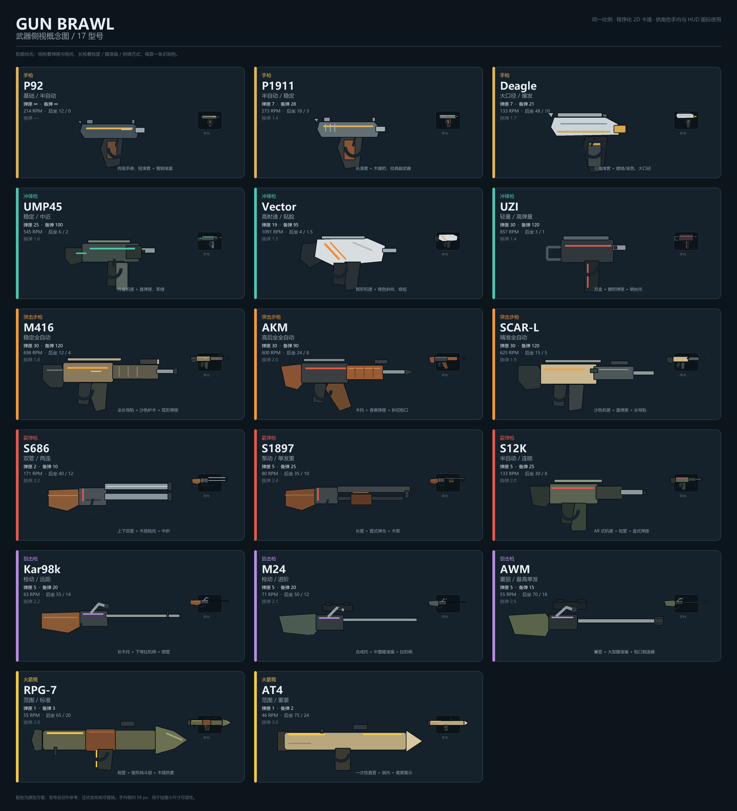

# 武器外观设计（提案）

更新：2026-10-17（北京时间）。状态：**设计提案，尚未接入代码**。当前 `CharacterArt` 把同一把手枪烘进所有角色图集，换枪不会换外观；本方案为 [17 个型号](./WEAPONS.md) 定义独立侧视轮廓、配色、手内尺寸和 HUD 识别规则。

概念图为同一比例、程序化 2D 卡通侧视；右上角小框是约 58 px 的手内可读性检查。正式发布前如涉及商标，可替换型号名，外观语言不变。

## 1. 美术方向

- **轮廓优先**：先看枪种，再看型号。短枪靠弹匣 / 枪托区分，长枪靠枪管、瞄准镜、供弹方式区分。
- **低细节、高对比**：每把枪 2—4 个主色 + 1 条家族识别色；深色描边 1.2—1.5 px；不使用照片纹理、渐变噪点、真实商标或游戏素材。
- **手内可读**：角色高约 96 逻辑像素，手枪手内长度约 20—25 px，长枪 42—50 px；轮廓必须在不看 HUD 时也能区分。
- **HUD 可读**：32 px 图标只保留枪种剪影 + 家族色条，不画木纹、螺丝、小字。
- **同一朝向**：侧视朝右绘制，角色朝左时整体 `flipX`；枪口、弹匣、拉机柄的朝向不能靠文字说明。
- **不做写实**：木材用 2—3 条深色木纹表示，金属用一条高光表示，聚合物用大色块表示；保持和现有角色、地图同一套卡通语言。

## 2. 家族识别色

| 家族 | 识别色 | 主体 / 暗部 | 材质提示 |
| --- | --- | --- | --- |
| 手枪 | 黄铜 `#E0B45A` | 蓝灰钢 `#44515B` / 深灰 `#232B31` | 短滑套、木握把、金属高光 |
| 冲锋枪 | 青绿 `#4FC3B1` | 军绿 `#3F4D48` / 黑绿 `#2B3532` | 方盒机匣、聚合物、直弹匣 |
| 突击步枪 | 橙 `#F0A23A` | 沙色 / 橄榄 `#8A7A5C` / 深灰 `#2E3638` | 长导轨、弧形或直弹匣 |
| 霰弹枪 | 红 `#E05A4F` | 枪钢 `#4A5155` / 木色 `#8B5A36` | 粗管、双管 / 管式弹仓 / 盒式弹匣 |
| 狙击枪 | 紫 `#B48CE0` | 橄榄 / 合成托 `#59644A` / 深灰 `#343B3F` | 长枪管、瞄准镜、拉机柄 |
| 火箭筒 | 警示黄 `#F2C94C` | 军绿 `#5F6248` / 沙色 `#B9A77E` | 粗管、锥形战斗部、肩托 |

识别色只出现在一条细线、准星、弹匣底或枪口环上，不把整把枪涂成高饱和色。这样角色服装、地图主题再多，也能一眼看出枪种。

## 3. 逐型号外观

“手内”是逻辑像素，按角色高 96 px 设计；不是最终贴图尺寸。

| 型号 | 轮廓与识别点 | 颜色 / 材质 | 手内 |
| --- | --- | --- | --- |
| P92 | 短滑套、圆润机匣、外露击锤；没有枪托 | 蓝灰钢 + 深灰握把 + 黄铜准星 / 扳机线 | 20 px |
| P1911 | 比 P92 更长的滑套、木质握把、圆形击锤、滑套防滑纹 | 旧钢灰 + 胡桃木 + 黄铜细线 | 22 px |
| Deagle | 巨大的三角滑套、粗枪口、顶部导轨；握把明显后倾 | 镀铬银 + 金色枪口 / 扳机 + 黑色握把 | 25 px |
| UMP45 | 方盒机匣、直弹匣、折叠托；枪管很短 | 军绿聚合物 + 黑绿托 + 青绿识别线 | 30 px |
| Vector | 楔形机匣、极短枪管、前倾弹匣；枪身像折线 | 白灰 / 银灰 + 黑色握把 + 橙色斜纹 | 29 px |
| UZI | 方盒机匣、弹匣在握把内、钢丝托；最紧凑 | 黑灰钢 + 红色拉机柄线 + 深色握把 | 27 px |
| M416 | 长导轨、沙色护木、弧形弹匣、伸缩托 | 沙色 / 橄榄 + 深灰护木 + 橙色线 | 42 px |
| AKM | 木托 + 木护木、香蕉弹匣、斜切枪口、拉机柄在右侧 | 胡桃木 + 黑钢 + 红色识别线 | 42 px |
| SCAR-L | 一体化长机匣、直弹匣、长导轨、侧拉机柄 | 沙色 + 深灰 + 橙色线 | 42 px |
| S686 | 上下双管、木质枪托、中折铰链；枪口两个圆环 | 枪钢 + 胡桃木 + 红色铰链线 | 40 px |
| S1897 | 长枪管、下方管式弹仓、木泵、木托 | 黑钢 + 深木色 + 红色管口线 | 40 px |
| S12K | AR 式机匣、短粗枪管、盒式弹匣、顶部导轨 | 橄榄聚合物 + 深灰 + 红色线 | 38 px |
| Kar98k | 长木托、细长枪管、下弯拉机柄、无瞄准镜 | 胡桃木 + 旧钢 + 紫色准星线 | 46 px |
| M24 | 合成托、中置瞄准镜、直拉机柄、比 Kar 更粗的枪管 | 军绿 / 黑 + 深色镜筒 + 紫色线 | 47 px |
| AWM | 重型长枪管、大型瞄准镜、枪口制退器、角形枪托 | 橄榄绿 + 黑 + 紫色线 | 50 px |
| RPG-7 | 粗发射管、锥形战斗部、木隔热套、后喇叭口、手枪握把 | 军绿管 + 木色隔热套 + 黄色警示线 | 45 px |
| AT4 | 一次性直管、锥形前盖、肩托、简易瞄具；没有木件 | 沙色管 + 深灰肩托 + 黄色环带 | 43 px |

### 轮廓速记

- **手枪**：短、没有枪托、握把占视觉重心。P92 圆、P1911 长、Deagle 大三角。
- **冲锋枪**：短枪管 + 大弹匣；UMP 方、Vector 楔、UZI 盒。
- **突击步枪**：长机匣 + 弹匣 + 枪托；M416 弧形弹匣、AKM 香蕉弹匣 + 木、SCAR 直弹匣 + 长导轨。
- **霰弹枪**：粗管；S686 双管、S1897 管式弹仓 + 泵、S12K 盒式弹匣。
- **狙击枪**：最长；Kar 木托无镜、M24 有镜、AWM 重管 + 大镜 + 制退器。
- **火箭筒**：最粗；RPG 锥形战斗部 + 木套、AT4 直管 + 肩托。

## 4. 枪口、后坐与换弹表演

| 家族 | 枪口火光 | 后坐视觉 | 换弹动作 |
| --- | --- | --- | --- |
| 手枪 | 小型三尖星，0.06 s | 枪口上抬 2—3 px，握把后移 | 退弹匣 / 上弹匣，滑套后拉 |
| 冲锋枪 | 短锥形火光，0.04 s | 枪身后缩 2 px，轻微上抬 | 枪身侧倾，弹匣直插 |
| 突击步枪 | 三尖星 + 少量烟，0.05 s | 枪身后缩 3 px，枪口上抬 | 弹匣拍入 + 拉机柄 |
| 霰弹枪 | 宽扇形火光 + 烟环，0.09 s | 明显后缩，枪口大幅上抬 | S686 中折，S1897 泵动，S12K 换盒 |
| 狙击枪 | 细长条火光 + 侧向燃气，0.12 s | 最强后缩 / 上抬 | 拉机柄循环，弹匣更换 |
| 火箭筒 | 尾部燃气 + 前方烟团，0.18 s | 最大后坐，角色向后滑 | 后部装填，动作最慢 |

- 枪口火光画在**视觉枪口**，但弹丸仍从现有 `x + 27, y - 28` 出生，避免改变命中时序；两者相差的部分用枪口长度消化。
- 后坐视觉只做 2—3 px 位移和 0.05—0.12 弧度旋转，不替代实际 `recoil` 物理冲量。
- 换弹动作不超过换弹时间；如果时间不够，优先保留“弹匣 / 枪机”关键帧，不补中间帧。

## 5. HUD 图标

- 32 × 32 图标：枪身用 1 条深色轮廓 + 2 个主色块，家族识别色放在枪口 / 弹匣底线。
- 手枪图标不需要画手；长枪把枪托缩到 2—3 px，保证枪管和弹匣仍可辨。
- 当前 HUD 的 `枪名 · 弹匣/备弹` 放在图标右侧；没有图标时不能只靠文字。
- 图标与手内模型共用同一份轮廓数据，不另画一套完全不同的形状。

## 6. 与当前代码的差距

当前实现：

- `CharacterArt.paintCharacter` 在角色右臂后直接画一把固定手枪（约 20 px），并烘进每个外观图集。
- `ArenaRenderer` 只为每个角色创建一张 character sprite；没有独立武器 sprite、武器切换或枪口锚点。
- 当前有六把类别枪（含通用火箭）；17 个具体型号还没有注册表 ID。

接入建议：

1. 新增 `src/presentation/WeaponArt.ts`：
   - `paintWeapon(ctx, weaponId, { recoil, reload })`：本地坐标以握把为原点，枪口朝右。
   - `createWeaponTexture(weaponId)` / `weaponTextureKey(weaponId)`：按型号缓存，不按角色外观复制。
   - `WEAPON_VISUALS`：轮廓、主色、识别色、手内长度、枪口偏移、换弹动作。
2. `CharacterArt` 删除固定的手枪路径，只保留手臂 / 手；武器改为独立层，避免 5 种外观 × 17 把枪生成 85 张角色图集。
3. `ArenaRenderer` 为每个 actor 增加 weapon sprite：
   - 位置 = 角色手部锚点；`flipX` 跟随角色朝向；
   - 深度在角色之上、名字标签之下；
   - 换枪时只换 weapon texture，不重建 character atlas；
   - 开火帧按 `weapon.recoil` 做短位移 / 旋转，枪口火光用视觉枪口。
4. 数据来源：`ActorState.weapon.definition.id`；在 17 个型号 ID 落地前，先按六个家族画六把占位轮廓。
5. 验证：训练场摆一排 17 把枪截图；HUD 32 px 图标截图；角色左右朝向、跑动 / 空中 / 开火 / 换弹；确认没有改变碰撞、弹丸出生点和后坐力数值。

这一步会修改 `CharacterArt` / `ArenaRenderer`，属于 T10.4 与 T01 型号系统的交叉；当前工作区有并行地图改动，建议等地图会话提交后再接，避免抢文件。

## 7. 待确认

1. 是否保持现在的扁平卡通 + 深色描边，还是提高到更写实的厚涂 / 像素风？
2. 17 把全部做独立模型，还是先做六个家族轮廓、型号只换配色和配件？
3. 手内长枪是否允许超过 40 px（更醒目但可能挡住角色）？
4. 型号名是否先用 P92 / M416 / AKM 等参考名？
5. 是否在训练场加入“武器墙”用于逐把试看和截图验收？

确认后我优先做 `WeaponArt + 角色独立武器层`，不改任何战斗数值。
